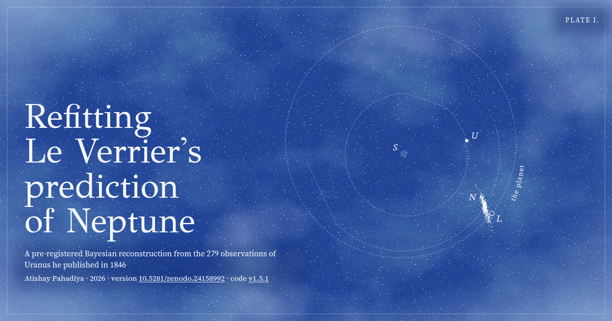
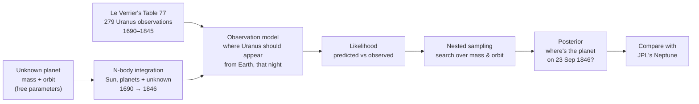

# neptune-fork

**In 1846, Urbain Le Verrier worked out where an unseen planet had to be from small errors in Uranus's orbit. Astronomers pointed a telescope there and found Neptune. I rebuilt his prediction from his own 279 observations, with an orbit integrator I wrote for this and Bayesian inference. The model is never told Neptune exists. On the night Neptune was found, it puts the planet at 325.8° (68 % interval 323.6°–327.8°); Neptune was at 325.87°.**

[**Full results and every caveat →**](https://atishaypahadiya.github.io/neptune-fork/) · [The British search](https://atishaypahadiya.github.io/neptune-fork/adams-challis/) · [Run it in three commands](#run-it) · [Dataset (Zenodo, CC0)](https://doi.org/10.5281/zenodo.24044791) · [Cite](#cite-and-license)

[](https://github.com/atishaypahadiya/neptune-fork/actions/workflows/test.yml)
[](https://github.com/atishaypahadiya/neptune-fork/actions/workflows/pages.yml)
[](https://doi.org/10.5281/zenodo.24044791)
[](https://doi.org/10.5281/zenodo.24121059)

[](https://atishaypahadiya.github.io/neptune-fork/)

*Plate I of the write-up: the planet on Galle's night, 23 September 1846, in heliocentric positions projected on the ecliptic of date, to scale. S is the Sun and U is Uranus. The stipple is samples of the headline posterior. N is Neptune (JPL Horizons) and L is Le Verrier's planet from his published elements.*

---

## The result

On 23 September 1846, the night Johann Galle found Neptune:

| | This fit | Real Neptune (JPL) | Le Verrier, 1846 |
|---|---|---|---|
| Where to point the telescope (geocentric longitude) | **325.8°** (68 %: 323.6°–327.8°) | 325.87° | 324.97°¹ |
| Mass | **17.3 Earths** (16.3–18.4) | 17.15 | 35.7 Earths (1/9322 of the Sun)² |
| Distance from the Sun (semi-major axis) | **30.2 AU** (29.6–30.9) | 30.07 AU | 36.15 AU |

The only input is Le Verrier's own table of Uranus observations (Table 77: 279 observations, 529 measured coordinates, 1690–1845). The planet's mass, orbit and position are inferred from how Uranus drifts off course.

¹ Computed here from his published elements of 31 August 1846: 0.90° short of Neptune in geocentric longitude on Galle's night. Le Verrier's own figure for his miss, 52′ (0.87°), is a different quantity: a heliocentric difference at 1 January 1847. He reduced Galle's observed place to heliocentric longitude, carried it to 1 January 1847, and compared it with the heliocentric longitude he had published for that date (*Recherches sur les mouvements de la planète Herschel*, 1846, p. 253). The held-distance comparison below uses his 52′ as its window, which was fixed in advance; recomputed after the results with a 0.90° window, its counts are 36 % and none, and the bound is unchanged ([note](docs/notes/M6d.md)).
² *Recherches*, § 137, p. 234: the mass of the new planet is 1/9322 of the Sun's.

## What surprised me

- **Whether his own data rule out his 36 AU depends on the error model.** He put the planet at 36 AU, and the real Neptune is at 30. Under the pre-registered Gaussian error model, his data exclude 36 AU (Δ ln L = −3.15). Under heavier-tailed Student-t errors, which the data favour (Bayes factor ln B = +13.7), 36 AU is not disfavoured (Δ ln L = −0.76). By the rule fixed before that run, the Student-t profile reads as partial, so that is a description of the curve, not a finding.
- **Ten measurements carry the near side of the distance.** Drop the 37 measurements made before 1781, the year Herschel found Uranus, and the distance profile goes flat under either error model. Under Student-t errors, the only model on which each early observer was dropped in turn, dropping Flamsteed's 10 alone makes it flat too, while dropping Bradley's, Mayer's or Le Monnier's leaves it almost unchanged.
- **His accuracy is hard to reproduce from his own assumption.** With the distance held at his values (38.4 AU, the Bode's-law distance of his first paper, or 36.154 AU from his elements of 31 August 1846), under the pre-registered Gaussian error model, the fit puts the planet 10.6° and 9.0° short of Neptune, and none of 6,000 posterior draws land within 0.87° of Neptune, the size of his own 52′ miss.¹ With the distance free, 35 % do. That window was chosen after the event, so this is a description, not a test.
- **Adams's assumed distance alone would have missed by 8° to 10°; his data brought him within about 2°.** John Couch Adams made the rival British prediction. At his assumed distance, every method I tried on noise-free data lands 7.8° to 10.4° short of Neptune. His two final solutions place the planet 1.7° and 2.5° from Neptune on Galle's night. That nearness belongs to his data or their reduction; which of the two, I could not settle. → [The British search](https://atishaypahadiya.github.io/neptune-fork/adams-challis/)

## How it works



What's built, and how each piece was checked:

- **Orbit integrator.** A Wisdom–Holman symplectic integrator written for this project. It matches REBOUND, the standard N-body library, to about 2 × 10⁻⁹ arcseconds in Uranus's longitude over 1781–1846. REBOUND appears only in the tests.
- **Observation model.** Converts a simulated Uranus position into where an observer of 1690–1845 would have recorded it (apparent place, ecliptic of date), with error offsets for each group of observations.
- **Inference.** Partitioned nested sampling (dynesty) over the planet's mass and orbit. It gives the Bayesian evidence for each model, not just a best fit, which is how the error models are compared.
- **Calibration before touching real data.** On synthetic data, the true planet falls inside the 68 % interval in 8 of 10 noise realisations (two-sided binomial p = 0.52), so the intervals mean what they claim.
- **Pre-registration.** Each analysis plan was committed to the repository before the run. Changes made afterwards are labelled as amendments.
- **The data.** Le Verrier's Table 77 was transcribed twice from two scans, and a third scan settled every disagreement. It is published on Zenodo under CC0.

Scale: 1,319 CPU-hours in all ([ledger](site/data/ledger.json)).

## The British search

A companion study puts two questions to the printed record of the British search. [Read it →](https://atishaypahadiya.github.io/neptune-fork/adams-challis/)

- **How good were Adams's solutions?** His two final solutions place the planet 1.7° and 2.5° from Neptune on Galle's night, and from his printed normal equations I reproduce both to 0.011° and 0.003°. Fitted at the distances he assumed, the model is 10.5° and 9.1° short. On a noise-free Neptune at his first distance, his least squares is 9.5° short, the model on his places 7.8° and the fit 10.4°. So the shortfall belongs to the assumed distance. Whether noise alone explains his nearness is not settled: the post hoc test gives 0.017, which reads as weak.
- **The "12° from Neptune" figure.** Rawlins (*DIO*, 1999) puts Adams's place of 2 September 1846 about 12° from Neptune. That place, a mean longitude of 315° 20′, was an extrapolation beyond his last solution, offered with a hedge, and his memoir later retracted the reasoning behind it. It was not a computed solution. It lies 11.7° from Neptune. His last two computed solutions are the ones within about 2°. ([Note on Adams's solutions](docs/notes/P1B_adams_solutions.md))
- **Could Challis have recognised the planet before 23 September?** He recorded it twice in August without knowing. A model of his search conditioned on his record (100,000 kept draws) gives 0.71 (0.50 to 0.97) had he finished the comparison of 12 August with 30 July that he broke off. His actual procedure is 0 by construction, because the realised events are held fixed. Zones laid from Adams's first place or from Le Verrier's give 0.41 and 0.41, or 0.79 and 0.85 with prompt comparison. Each depends on an input the record does not fix, and none reaches "very probably".

## Run it

```bash
uv sync
uv run pytest -m "not slow and not network"   # the CI suite, offline
uv run python examples/toy_fit.py             # a few minutes, one core
```

`toy_fit.py` runs the real pipeline on one prior cell at low resolution. It's a demo, not the result. Full runs need JPL Horizons states (`uv run python -m fork.data.horizons --fetch`). Commands and runtimes for every milestone are in [docs/reproduce.md](docs/reproduce.md).

## Prior work

Reconstructing Neptune from Uranus is well-trodden ground. The closest work:

- [discoverneptune](https://jbwhit.github.io/discoverneptune/) (Whitmore, 2026) is a REBOUND reconstruction fitted to JPL-derived annual longitudes.
- Lai, Lam & Young (1990) is cited as giving the forward and inverse treatment of Uranus's perturbations by Neptune; I have read only its abstract.
- The CoFI inference framework has a "Finding Neptune using Uranus" example.
- A KTH thesis (2018) is reported to solve it by Gauss–Newton with RK4; I have not read it.

**What this project adds:** a fit to Le Verrier's actual historical observations rather than a modern proxy, Bayesian evidence across error models, error offsets for each group of observations, and a profile of the planet's distance under two error models. Sampling a posterior and tracing the mass–distance trade-off are *not* new: discoverneptune does both. Details are in the [novelty note](docs/notes/prior_work/novelty.md).

## Limitations

- **The Gaussian error model is the headline even though the data prefer Student-t,** because Gaussian was pre-registered. Under Student-t the median moves 0.37 headline half-widths, and the 68 % interval widens from 4.22° to 6.33°.
- **The 95 % interval (319.6°–330.1°) is provisional.** When eccentricity is allowed up to 0.5, a low-distance solution near 314° gets a weight between 0.001 and about 0.2, and repeated runs disagree on it.
- **The transcription spot-check found 0 errors in 28 rows.** That bounds the row error rate below 10.1 % (95 %). The other 251 rows were not spot-checked.
- **The observation model ignores diurnal parallax,** which is up to 0.5″ for Uranus over this period.
- **The companion study reads only the printed record** and one set of Adams's manuscripts. It did not use the Cambridge observing books or Airy's papers.

The full list is in the [write-up](https://atishaypahadiya.github.io/neptune-fork/)'s Limitations, and every plan with its amendments is in [docs/PHASE1_SPEC.md](docs/PHASE1_SPEC.md).

## What's next

The point of the code is the "fork" in the name. When an orbit doesn't behave, three explanations compete: **a hidden mass, a change to the law of gravity, or bad data.** Neptune is the case where the answer is known, so it's the calibration run. Next, the same engine weighs those three against each other on cases where the answer isn't known. Mercury's perihelion is the classic one: Le Verrier blamed a hidden planet, and the real answer was general relativity. The Mercury data (Newcomb's transit timings and Le Verrier's Paris observations) are already transcribed. The two identifiability studies run so far both stopped at their pre-registered gates, so no claim is made yet.

## Repository map

```
src/fork/
  integrators/   Kepler solver, Wisdom–Holman, leapfrog, RK4
  model/         forward model, hidden planet, apparent place, observation model
  inference/     priors, least squares, profile likelihood, emcee, dynesty
  data/          Horizons cache, frames, Table 77 loader, error calibration
  export/        site data, run schedulers, compute ledger
data/historical/ Le Verrier's Table 77: both transcriptions, misprints, error model
docs/            method, reproduction, spec, notes
site/            the write-up (GitHub Pages); every number is read from site/data/
tests/           pytest, with offline Horizons fixtures
```

Start with [docs/method.md](docs/method.md), the whole method on one page.

## Cite and license

- **Dataset:** [10.5281/zenodo.24044791](https://doi.org/10.5281/zenodo.24044791) (all versions) · [10.5281/zenodo.24158992](https://doi.org/10.5281/zenodo.24158992) (v1.0.1, for exact reproduction)
- **Code:** [10.5281/zenodo.24121059](https://doi.org/10.5281/zenodo.24121059) (all versions) · [10.5281/zenodo.24357494](https://doi.org/10.5281/zenodo.24357494) (v1.5.1). [CITATION.cff](CITATION.cff) lists every release.
- **Licenses:** code is MIT. Everything in `data/historical/` is CC0. Le Verrier's 1846 memoir is public domain, and its scans are listed with hashes in [MANIFEST.md](data/historical/sources/MANIFEST.md).
