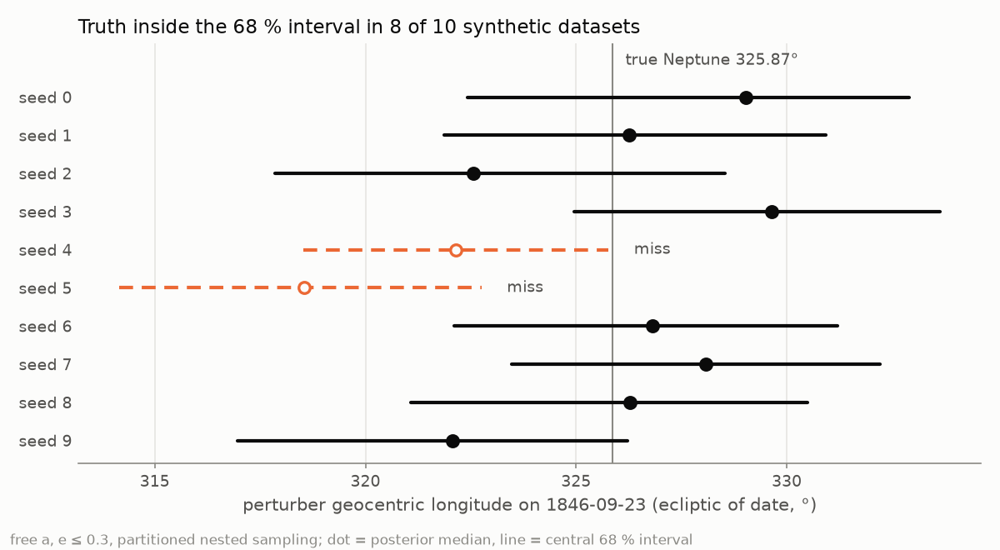
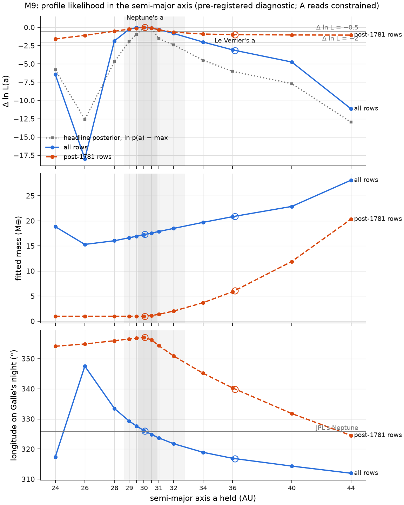

# neptune-fork

[](https://github.com/atishaypahadiya/neptune-fork/actions/workflows/test.yml)
[](https://github.com/atishaypahadiya/neptune-fork/actions/workflows/pages.yml)
[](https://doi.org/10.5281/zenodo.24044791)
[](https://doi.org/10.5281/zenodo.24121059)

Refitting Le Verrier's prediction of Neptune from his observations of Uranus.

## Abstract

Fitted to Le Verrier's own 1846 observations of Uranus, without any knowledge of Neptune, the
model places the unseen planet at **325.8°** on the night Galle found it, 0.06° from Neptune's
true position.

The longitude is geocentric (ecliptic of date) on 23 September 1846, from partitioned nested
sampling of the 279 observations in his Table 77 (529 measured coordinates, 1690–1845) under a
plan committed before the run. The model is our own Wisdom–Holman integrator, an apparent-place
observation model, and a perturbed orbit that is never given Neptune; Neptune (JPL) was at
325.87°. The 68 % range is 323.6°–327.8° under the pre-registered Gaussian errors and
321.0°–327.3° under Student-t errors, which the evidence favours (ln B = +13.7); Neptune is
inside both. The 95 % range, 320.2°–330.4°, is provisional.

The headline fit gives a mass of 17.3 M⊕ (68 %: 16.3–18.4; Neptune 17.15), a semi-major axis
of 30.2 AU (29.6–30.9), osculating in 1781, and an eccentricity below 0.028 (68 %, one-sided).
Le Verrier's published elements, carried to that night, give a geocentric longitude of 324.97°,
inside the 68 % range. In heliocentric longitude his planet lies outside the 95 % range at the
conjunction of 1821 and stays within the 68 % band only from 1835.75 to 1856.50. The
observations before 1781, chiefly Flamsteed's, rule out distances below about 28.5 AU under either
error model (Δ ln L = −2 at 28.0 and 28.7 AU). Under Gaussian errors they also exclude distances
beyond 34.0 AU; under the Student-t errors the evidence favours, the far side opens to 40.6 AU and
Le Verrier's 36 AU is not disfavoured (Δ ln L = −0.76).

Phase 2 will extend the code to weigh three
explanations of an orbital anomaly against each other: a hidden mass, a modified law of
gravity, and error in the data.

The site (`site/`) presents the result as a short paper with plates; every number on it is read
from `site/data/`.

## Calibration on synthetic data



*Coverage test on synthetic data.* Each row is one noise realisation: the posterior
median and central 68 % interval for the inferred planet's longitude on 1846-09-23. True Neptune
(325.87°) lies inside 8 of the 10 intervals; for calibrated 68 % intervals that count gives a
two-sided binomial p = 0.52. The intervals are 7–11° wide.

Two noise-free checks:
- **Point fit (least squares):** recovers Neptune's 1846 longitude to 0.07°; the model and
  fitter are unbiased.
- **Posterior:** wider, with its median at 322.05° against the true 325.87°, a −0.75σ
  offset along the mass–distance degeneracy, where the likelihood is flat.

## Status

Phase 1. The stages on synthetic data are complete:

- frames;
- the Kepler solver;
- the integrators, which match REBOUND to 2e-9″;
- the forward model;
- point fits and the profile likelihood;
- partitioned nested sampling with its calibration tests.

The pre-registered fit to the real data (the headline fit) is done and reported, and so are the
acceptance tests on the historical data ([report](docs/notes/A6.md)). The Peirce-number analysis
and the held-out test on Neptune's precoveries are deferred to v1.3. The spec's other variants of
the headline fit (the `bouvard` and `adams` data
variants, the 1846 reduction track and the Le Verrier shape model) are deferred to v1.3 too:
they are not yet pre-registered, will be planned and pushed before launch, and the `adams`
variant opens the Adams–Challis study. The higher-resolution reruns with a faster likelihood did
not meet the 95 % stability condition, so the 95 % interval stays provisional. The full-likelihood
check of the eccentricity test has reported: by its pre-registered rule the published verdict
stands and the question is unresolved (Robustness, below). Two pre-registered profile likelihoods
in the semi-major axis are done, on Gaussian errors ([M9](docs/notes/M9.md)) and on Student-t
errors ([M10](docs/notes/M10.md)): the near side of the distance comes from the pre-1781
observations under both; the far side depends on the error model (Robustness).

**Data and model.** Le Verrier's 279 observations are transcribed and double-checked
(`data/historical/`), and the apparent-place observation model and the error calibration are
built. A coverage test on synthetic data with the real data's error model passed: the truth is inside the 68 % interval for
8 of 10 seeds (two-sided binomial p = 0.52), with an rms offset of 0.87σ and a median 68 % width
of 5.1°. That is narrower than the 9.1° of the earlier synthetic posteriors, mostly because
Table 77 has more measurements and smaller calibrated errors than they assumed
([notes](docs/notes/M6.md)).

**Result.** On Table 77 we find the planet at 325.8° on Galle's night (68 %:
323.6°–327.8°), with a sampler systematic of ±0.13° on the median. JPL's Neptune, 325.87°, is
0.03 half-widths from the median. Le Verrier's prediction, carried from his published elements
to that night (324.97°, geocentric, ecliptic of date), is also inside the interval. The posterior puts 37 % of its probability
within Le Verrier's 52′ miss of the true position (the Peirce probability). These figures are
derived after the fact from the pre-registered replacement posterior described below.

**Robustness.** JPL's Neptune is inside the 68 % interval in the headline fit and in all three
pre-registered sensitivity runs (e ≤ 0.5; error levels estimated from the data alone; Student-t
errors). The medians agree to within 0.4 headline half-widths. With eccentricity allowed up to
0.5, the published run gives P(a < 25 AU) = 0.001 ("not at all"); the fast-likelihood check
(0.109) and the full-likelihood check (0.12–0.19, depending on the other cells' evidence)
disagree with it, and the full-likelihood check's own two seeds disagree beyond tolerance; by
the pre-registered rule the published verdict stands and the question is unresolved
([notes](docs/notes/M8.md#a8ds1-arbiter-results-2026-11-10)). The evidence favours the
Student-t errors (ln B = +13.7), but the Gaussian error model was fixed by the
pre-registration and is kept. Under Student-t errors the median is insensitive to it (it moves 0.37
headline half-widths), but the 68 % interval widens from 4.22° to 6.33°.

**Distance.** A pre-registered profile likelihood in the semi-major axis
([M9](docs/notes/M9.md)) asks whether the data fix the planet's distance. With a held at 13
values from 24 to 44 AU and everything else re-fitted, all 279 observations give a maximum at
30 AU, fall 2 in ln L below it at 28.0 and 34.0 AU, and put Le Verrier's 36.15 AU 3.15 below
Neptune's 30.07 AU: the profile reads as constrained, and the headline posterior's 95 % range in
a (28.7–32.8 AU) lies inside it. Without the 19 observations before 1781 (37 measurements by
Flamsteed, Le Monnier, Bradley and Mayer) the same profile stays within 1.1 of its maximum from
26 to 44 AU, with the fitted mass on the prior's 1 M⊕ floor up to 30 AU and the eccentricity on
its 0.3 bound beyond: it reads as flat. By the rule committed beforehand, the distance comes from
the pre-1781 observations. This profile uses the Gaussian error model; nothing in the headline
changes.



*Profile likelihood in the semi-major axis (M9).* Top: Δ ln L against the held a for all rows
(solid) and the rows from 1781 on (dashed), with the headline posterior's marginal in a (dotted)
and the Δ ln L = −0.5 and −2 lines; open circles mark Neptune's and Le Verrier's a. Middle: the
fitted mass. Bottom: the longitude on Galle's night, with JPL's Neptune.

The same profile was then pre-registered under Student-t errors (ν = 4, with the scales of the
Student-t sensitivity run), the model the evidence favours ([M10](docs/notes/M10.md)), on six data
sets: all observations, the observations from 1781 on, and all observations less each pre-1781
observer's measurements in turn. With all observations the maximum moves to 32 AU and the curve
falls 2 in ln L below it at 28.7 AU on the near side, but not within 4 AU on the far side (−0.72
at 36 AU), and it is still within 2 at 40 AU: by the rule committed beforehand it reads as
partial, and no conclusion is drawn from it. What the curves show, as description rather than a
reading of the rule: the near side is the same under both error models (Δ ln L = −2 at 28.0 and
28.7 AU; at 26 AU −18.0 against −16.6), while the far side depends on it: the crossing moves from
34.0 to 40.6 AU and Le Verrier's 36.15 AU from 3.15 to 0.76 below the maximum (Neptune's 30.07 AU
is 0.33 below). Without the pre-1781 observations the curve again reads as flat, within 0.5 of its
maximum from 26 to 44 AU. Without Flamsteed's 10 measurements alone it reads as flat too, within
1.1 over the same range, and the fit changes family: at 30 AU the planet points to 312.4° on
Galle's night with 23 M⊕, against 326.3° and 17 M⊕ with all observations. Without Bradley's 1,
Mayer's 2 or Le Monnier's 24 the curve is almost unchanged (all partial, maxima at 32, 32 and
31 AU). The near side of the distance rests on Flamsteed's measurements; the rule reads the
leave-one-out sets only when the all-observations profile is constrained, so this is a
description of the curves, not a reading. The Student-t posterior's 95 % range in a is 7.99 AU
wide, which the plan's amendment calls borderline, so no tight/loose claim is made about it.


*Profile likelihood in the semi-major axis under Student-t errors (M10).* Left: Δ ln L against the
held a for all rows and for the rows from 1781 on, with M9's Gaussian curves dotted and the
Student-t posterior's marginal in a; open circles mark Neptune's and Le Verrier's a. Right: the
same profile without Flamsteed's, Bradley's, Mayer's or Le Monnier's measurements, each over the
all-rows curve.

**Repeatability.** Repeated runs of the main sampling cell disagreed on the width by far more
than the sampler's own error estimate. Under a pre-registered repeatability study, two runs with
4× the live points agreed on the width, and their merge replaced that cell. This widened the
first published interval (323.9°–327.4°) by about 20 %, to the one above
([repeatability notes](docs/notes/M6.md#m6c-cell-2-repeatability-results-2026-11-08)). The 68 % interval
is the headline. The 95 % interval (320.2°–330.4°) is provisional: it widened from 6.6° to 10.2°
because it depends on the small weights of three cells that are still single runs. A faster
likelihood ([Phase 1 spec](docs/PHASE1_SPEC.md#m8-fast-linearized-likelihood)) made repeated
runs of every cell affordable; its higher-resolution reruns did not meet the 95 % stability
condition, so the 95 % interval stays provisional.

**Phase 1b: the British search (release v1.2.0).** A companion
study, [on its own page](https://atishaypahadiya.github.io/neptune-fork/adams-challis/), asks
two questions of the printed record.

- *How good was Adams?* At the distances he assumed, the project's fit is 10.5° and 9.1° short
  of Neptune at epoch 1846.762 (5 October 1846). His solutions are reproduced from his memoir. On a noise-free
  Neptune at his first distance every method is short (his least squares 9.5°, the project's
  model on his places 7.8°, the project's fit 10.4°), so the shortfall belongs to the assumed
  distance and his nearness (+1.7° and +2.5°) to his data or their reduction. Whether noise
  alone accounts for it is not settled: the pre-registered statistic measured jumps to a second
  minimum, and the post hoc one (0.017 under the first hypothesis) reads weak.
- *Could Challis have recognised the planet before 23 September?* A detection model
  conditioned on his record (100,000 kept draws) gives, with the realised events held: his
  actual procedure 0 by construction (the realised events are held fixed, so the cases measure
  what a change would have added); the comparison he broke off, carried through,
  0.71 (0.50 to 0.97); zones laid from Adams's first place or from Le Verrier's June place 0.41 and 0.41 (both prior-dependent), or 0.79 and 0.85 with prompt comparison. Each depends on an input the record
  does not fix, three readings are prior-dependent, and none reaches "very probably".

The write-up, with each claim's JSON path and deviation, is
[docs/notes/P1B_writeup.md](docs/notes/P1B_writeup.md).

**Data availability.** Le Verrier's Table 77, transcribed, is on Zenodo (CC0).
- Concept DOI [10.5281/zenodo.24044791](https://doi.org/10.5281/zenodo.24044791) (the badge
  above) covers all versions; cite it for the dataset in general.
- Version DOI [10.5281/zenodo.24044792](https://doi.org/10.5281/zenodo.24044792) is v1.0.0;
  cite it for exact reproduction.
- Each release of the code is archived on Zenodo as well. v1.1.0: version DOI
  [10.5281/zenodo.24122940](https://doi.org/10.5281/zenodo.24122940), concept DOI
  [10.5281/zenodo.24121059](https://doi.org/10.5281/zenodo.24121059) for all versions
  (v1.0.0: [10.5281/zenodo.24121060](https://doi.org/10.5281/zenodo.24121060);
  `CITATION.cff` carries all three).

## Limitations

- The reduction check against JPL: comparison against per-group precision not made: no precision figure was fixed before the data were seen. Medians reported. Details in the [acceptance-test report](docs/notes/A6.md).
- The transcription check: 0 of 28 rows in error; 95 % upper bound on the per-row error rate 10.1 % (exact one-sided Clopper–Pearson, 0 of 28); the remaining 251 rows are unchecked.
- The observation model does not include diurnal parallax (up to 0.5″ for Uranus over 1781–1845).
- Only Le Verrier's data choice on the modern reduction track is fitted: the `bouvard` and `adams` variants, the 1846 reduction track and the Le Verrier shape model are deferred to v1.3 (not yet pre-registered; to be planned and pushed before launch; the `adams` variant opens the Adams–Challis study).
- Error model: the evidence favours Student-t errors (ln B = +13.7); the Gaussian error model
  was fixed by the pre-registration and is kept. Student-t errors move the median 0.37 headline
  half-widths.
- With eccentricity allowed to 0.5, a low-distance solution (a < 25 AU) pointing near 314° on
  Galle's night carries a posterior weight that the current runs do not determine (0.001 to
  about 0.2).
- The near side of the distance rests on the 37 measurements by four observers before 1781
  (Flamsteed, Le Monnier, Bradley and Mayer), and chiefly on Flamsteed's 10: without them the
  Student-t profile reads as flat, while without Bradley's, Mayer's or Le Monnier's it is almost
  unchanged. Their reduction and transcription matter most ([M9](docs/notes/M9.md),
  [M10](docs/notes/M10.md)).
- The far side of the distance depends on the error model: Δ ln L = −2 at 34.0 AU under Gaussian
  errors and 40.6 AU under Student-t errors; Le Verrier's 36.15 AU is 3.15 below the maximum
  under the first and 0.76 under the second.

- Phase 1b reads the printed record only: the Cambridge observing books, Airy's papers and
  Bouvard's tables were not consulted, and the limits of the Berlin sheet Challis had are from a
  secondary source.
- Phase 1b's probabilities for Challis's search are conditional on declared priors where the
  record is silent; under the reading reported, his actual procedure is 0 by construction: the
  realised events are held fixed, so the cases measure what a change would have added.

## Quickstart

```sh
uv sync
uv run pytest -m "not slow and not network"   # the CI suite: no network calls (Horizons states from tests/fixtures/)
uv run python examples/toy_fit.py             # a few minutes, one core, offline
```

`examples/toy_fit.py` runs the real pipeline on one of the four prior cells at nlive 20. It is
a demo, not a result. Fitting anything else needs JPL Horizons states:
`uv run python -m fork.data.horizons --fetch` caches them in `data/cache/`. Commands and
runtimes for each milestone are in [docs/reproduce.md](docs/reproduce.md).

## Project structure

```
src/fork/
  integrators/  Kepler solver, Wisdom–Holman (democratic heliocentric), leapfrog, RK4
  data/         Horizons cache, frames, synthetic data, Table 77 transcription and loader,
                error calibration
  model/        bodies, forward model, hidden-mass model, apparent place, RA/Dec observation model
  inference/    priors, least-squares fits, profile likelihood, emcee, dynesty (partitioned)
  export/       site/data/*.json writers, run schedulers, compute ledger
examples/       toy_fit.py: one-cell demo
tests/          pytest; `slow` and `network` markers; Horizons fixtures in tests/fixtures/ and tests/data/
data/historical/  Le Verrier 1846 Table n° 77: both transcription passes, resolution log,
                  misprints, loader output, error model
docs/           method, reproduction commands, Phase 1 spec, milestone notes, figures
site/           static site (GitHub Pages) and its data
```

## Documentation

- [docs/method.md](docs/method.md): the method in one page. It covers frames, the integrator
  and its REBOUND validation, the observation models, the priors, partitioned nested sampling,
  the calibration tests and the ×1.8 evidence-error inflation.
- [docs/reproduce.md](docs/reproduce.md): commands and ledger runtimes for each milestone.
- [docs/PHASE1_SPEC.md](docs/PHASE1_SPEC.md): milestones and acceptance tests, with every
  amendment.
- Milestone notes, with the numbers achieved and the surprises:
  - scaffold ([M0](docs/notes/M0.md))
  - frames and data access ([M1](docs/notes/M1.md))
  - Kepler solver ([M2](docs/notes/M2.md))
  - integrators and their validation against REBOUND ([M3](docs/notes/M3.md))
  - forward model and its residual test ([M4](docs/notes/M4.md))
  - point fits, profile likelihood, posteriors and their calibration ([M5](docs/notes/M5.md))
  - nested-sampling validation ([M5b](docs/notes/M5b_dynesty_validation.md))
  - historical data, observation model, headline fit ([M6](docs/notes/M6.md))
- Phase 1b, the British search:
  - the write-up ([P1B_writeup](docs/notes/P1B_writeup.md))
  - sources ([step 0](docs/notes/P1B_sources.md)), Adams's solutions
    ([1](docs/notes/P1B_adams_solutions.md)), Challis's search log
    ([2](docs/notes/P1B_challis_sweeps.md))
  - the fit at his distances ([3](docs/notes/P1B_adams_fit.md)), the reproduction
    ([3b](docs/notes/P1B_adams_reproduction.md)), noise against a systematic cause
    ([3c](docs/notes/P1B_adams_noise.md))
  - Challis's search as a detection model ([4](docs/notes/P1B_challis_detection.md))

## Compute

The ledger (`site/data/ledger.json`) records **1193 CPU-hours** to date: 1109 timed live, plus 83
estimated from logs. Phase 1 accounts for 1090 of them and Phase 1b for 103 (the fit at Adams's
distances 70.8, the reproduction 7.0, the noise test 24.9, the detection model 0.3). Phase 1
covers 1153 million likelihood evaluations, 624 million of them N-body
integrations over 1690–1846 and the rest the fast linearized likelihood. Nested sampling
accounts for nearly all of it: the posterior calibration on synthetic data, and the coverage
test with the real error model at 277 CPU-hours. The headline fit took 28.5, its sensitivity
runs 89, the repeatability study 104, the fast-likelihood validation with its reruns 54, the
full-likelihood check of the eccentricity test 98, the profile likelihood in the semi-major axis
0.2 under Gaussian errors and 3.1 under Student-t errors on six data sets.

## Prior art

This is well-trodden ground. We credit and benchmark against:

- Jonathan Whitmore, *discoverneptune* (2026): <https://jbwhit.github.io/discoverneptune/>.
  A REBOUND-based reconstruction reaching ~2.5–2.9″ RMS, and our benchmark for the historical
  fit.
- Lai, H. M., Lam, C. C., & Young, K. (1990): forward and inverse treatment of Uranus's
  perturbations by Neptune.
- CoFI (Common Framework for Inference): the example "Finding Neptune using Uranus".
- KTH thesis (2018): Neptune from Uranus by Gauss–Newton, with an RK4 integrator.
- For Phase 1b: Brookes (1970), a re-derivation of Adams's solutions that ours agrees with;
  Kowal & Drake (1980) on Galileo's recordings of Neptune; Mallama & Hilton (2018) for its
  magnitude; Kollerstrom (2006) and Krajnović (2016, 2021) on the British and German sides of
  the discovery.

What this project does differently:

- its own Wisdom–Holman integrator, with REBOUND used only in tests;
- full posteriors from partitioned nested sampling, with evidence;
- the mass–distance degeneracy made explicit;
- a forward-model interface built for comparing models in Phase 2.

## Citing and license

Citation metadata is in [CITATION.cff](CITATION.cff). The licenses are split ([LICENSE](LICENSE)):

- **Code:** MIT. This covers everything outside `data/historical/`.
- **Data:** CC0 1.0 (public-domain dedication) for everything in `data/historical/`: the
  Table n° 77 transcriptions, the resolution log, the misprint table, the loader output and the
  error model. Citing this project when you reuse them is appreciated but not required.

Le Verrier's 1846 memoir itself is in the public domain. Its scans are listed, with URLs and
hashes, in `data/historical/sources/MANIFEST.md`.
