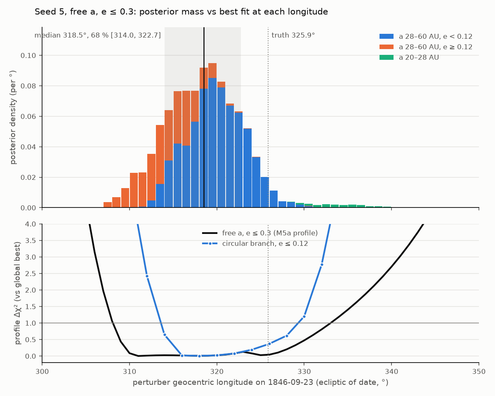

# M5: Inverse problem on synthetic data

M5 is split in two. **M5a** (this note) covers the point fits: multistart Levenberg–Marquardt, no
MCMC. **M5b** will add emcee posteriors and the A3 acceptance test.

## M5a: what was built
- `fork/inference/fit.py`: `fit_perturber_multistart`.
  - **Free variables:** Uranus a, e·cos ϖ, e·sin ϖ, λ₀, plus the perturber's log10 m [M⊕],
    a (free-a mode only), √e·cos ϖ, √e·sin ϖ and λ₀. Uranus's i, Ω are held at their 1781 values
    (docs/RULES.md rule 2).
  - **Modes:** Le Verrier mode (a = 38.4 AU, Bode) has 8 free parameters; free-a mode has 9.
  - **Starts:** 24 λ₀ values equally spaced over 0–360°. Every start shares one Uranus solution,
    taken from the data-only no-perturber fit. Every start also shares one neutral perturber
    start: m = 10 M⊕ (the middle of the M5 prior), a = 38.4 AU, and (√e cos ϖ, √e sin ϖ) =
    (0.1, 0). That √e is deliberately nonzero, because the e-gradient vanishes at k = h = 0.
    Nothing about Neptune enters.
  - **Guards:** e < 0.95, a > 1 AU and log10 m < 4 keep the forward model physical. Outside them
    the residuals are set huge, so LM rejects the step. The M5 prior (log10 m ∈ [0, 2],
    a ∈ [20, 60] AU, e ≤ 0.3) is *reported* per fit (`in_m5_prior`), not enforced. It's enforced
    in M5b's MCMC.
  - **Run classification:** each run is labelled `converged`, `stalled_at_guard` (stopped against
    a guard), `null` (the perturber improves χ² by less than 1 over the no-perturber fit), or
    `failed`.
  - **Distinct minima:** converged runs are clustered into minima. Two runs are the same minimum
    if Δχ² ≤ 0.5, Δλ₀ ≤ 5°, Δlog10 m ≤ 0.05 and Δa ≤ 3 AU. The a tolerance is loose on purpose:
    LM stops at different points along the flat mass–distance valley (one valley spanned
    a = 37.7–40.2 AU with identical χ²).
  - **Parallelism:** `n_workers` runs the starts in a process pool, with results identical to a
    serial run. All 24 starts take 8 s (Le Verrier) and 14 s (free a) on 12 workers.
- `fork/model/hidden_mass.py`:
  - `HiddenMassModel`, the 11-parameter model on the generic interface.
  - The (√e cos ϖ, √e sin ϖ) ↔ (e, ϖ) transforms.
  - `perturber_geocentric_longitude` and `true_neptune_geocentric_longitude`, both on
    1846-09-23 23:00 TDB, the hour of Galle's search (about Berlin midnight).
- `fork/model/forward.py`: `predict_states_ecl_j2000` returns every body's state; the kernel's
  initial-condition builder is shared with the longitude kernel.
- `fork/data/frames.py`: `geocentric_lon_lat_ecl_j2000_light_time` and `C_AU_PER_DAY`.
  - The target is moved back by v·τ. The error is ½·a·τ² ≈ 1e-8 AU for an outer planet.
  - Validated against JPL Horizons' astrometric position of Neptune on Galle's night: agreement
    **0.001″**. A hard-coded regression test and a live `network` test pin it.
  - True Neptune: **325.873°** ecliptic of date, 328.0135° ecliptic J2000.
- Horizons cache and offline fixture: Earth, Neptune and the inner planets at the Galle epoch.
  The fixture is rebuilt with `tests/data/build_horizons_fixture.py`.
- `site/data/m5a_fits.json` (17 KB) holds residual curves after fit (no perturber, Le Verrier, free
  a), observation residuals, the best fits, every local minimum, and the Galle longitudes. CI
  re-derives every curve from the committed θ; a slow test re-runs the whole export (~22 s).
- Plot: `M5a_residuals.png` (script `scripts/m5a_residuals_plot.py`, reads the JSON).

## M5a results (synthetic data seed 0, dt = 12 d)
True Neptune, for reference: m = 17.15 M⊕; osculating at 1781, a = 30.22 AU and e = 0.004.

| | Le Verrier mode (a = 38.4 AU) | free a |
|---|---|---|
| best m | **20.3 M⊕** | **15.5 M⊕** |
| best a | 38.4 AU (fixed) | **27.3 AU** |
| best e | **0.265** | **0.165** |
| χ²/dof | **0.956** (75.56 / 79) | **0.922** (71.91 / 78) |
| post-1781 residual RMS | **2.86″** (0.95σ) | **2.78″** (0.93σ) |
| distinct local minima | **6** (+2 starts stalled at the e guard) | **4** (+3 stalled, 1 null) |
| starts reaching the best minimum | 8 / 24 | 6 / 24 |
| 1846-09-23 geocentric longitude (of date) | 319.00° | 337.65° |
| minus true Neptune (325.87°) | **−6.87°** | **+11.77°** |

For comparison: with no perturber, χ²/dof = 21.6. With the true Neptune planted and Uranus
refitted, χ² = 75.22 (A2b). Both modes fit to the noise. Free a beats the planted truth (as it
must, since truth is inside its model family); Le Verrier mode is within Δχ² = 0.34 of it.

The other minima are worse in χ² (χ²/dof 1.22–2.34), several have e of 0.6–0.7 (outside the
prior), and they scatter in 1846 longitude from −67° to +153°. Two Le Verrier minima at
χ²/dof ≈ 22 are near-null: m = 1–3 M⊕ at e = 0.8–0.93. A 24-point λ₀ grid finds the best basin
from a third of its starts in each mode.

## Why the 1846 longitudes miss, and what it means for A3 (M5b)
A3 asks for the free-a *posterior* to put the 1846 longitude within 1°, and Le Verrier mode within
~2°. The point fits miss both. The cause was checked before reporting:

**Noise-free data** (Horizons truth, no noise, same schedule; `test_m5a_free_a_noise_free_recovers_neptune`):

| mode | m | a | e | 1846 longitude − Neptune |
|---|---|---|---|---|
| free a | 17.14 M⊕ | 30.24 AU | 0.004 | **−0.07°** |
| Le Verrier | 21.3 M⊕ | 38.4 | 0.246 | **−9.48°** |

**Noise seeds 1–4** (best of 24 starts):

| seed | free a: m, a, e → Δlon | Le Verrier: m, e → Δlon |
|---|---|---|
| 1 | 16.6 M⊕, 28.7 AU, 0.08 → +4.4° | 21.3 M⊕, 0.25 → −9.0° |
| 2 | 25.1 M⊕, 55.5 AU, 0.51 → −12.1° | 19.6 M⊕, 0.28 → −8.2° |
| 3 | 16.1 M⊕, 33.7 AU, 0.24 → −6.1° | 18.9 M⊕, 0.36 → −9.2° |
| 4 | 18.7 M⊕, 29.0 AU, 0.10 → +1.6° | 23.9 M⊕, 0.21 → −11.7° |

- **Free a: the model and fitter are unbiased.** Without noise they recover Neptune to 0.07°. With
  σ = 3″ annual normal places, though, the point estimate of the 1846 longitude scatters over
  about ±12° (seeds 0–4). The best fit always has lower χ² than the truth, by Δχ² ≈ 3.3 for
  seed 0. The data constrain the perturber's direction near the 1822 conjunction, but only weakly
  constrain a. That matters because the 1846 longitude is the conjunction longitude plus 24 years
  of mean motion, and mean motion depends on a. **Expect a broad free-a posterior in M5b.** It may
  fail "within 1°" for these data. If it does, the actual width is reported rather than tuned.
- **Le Verrier mode: a −8° to −12° bias** that persists without noise (−9.5°). At a = 38.4 AU the
  mean motion is 1.51°/yr, against Neptune's 2.19°/yr. Placing perihelion near the 1830s
  (e ≈ 0.25) speeds the perturber up, but over 1822–1846 it only partly closes the gap. The
  spec's "~2°" target looks optimistic for a strictly fixed 38.4 AU.
  - Historically, Le Verrier's final solution had a ≈ 36 AU and e ≈ 0.11, so his a was not
    strictly Bode's value. His real pre-discovery data also differed from this stand-in schedule.
  - Checked since (see "Diagnosing the 7–12° miss" below): Le Verrier's own a = 36.15 AU
    solution, the profile likelihood, and e caps. The real M6 dates remain unchecked. **The A3
    target has not been changed.**

## Diagnosing the 7–12° miss (before M5b)
Code:
- `fork/inference/profile.py` (profile likelihood).
- `PerturberSpace` in `fork/inference/fit.py`, which handles held variables and the e cap.
- `LE_VERRIER_1846` in `fork/model/hidden_mass.py`.

Numbers:
- `site/data/m5a_profile.json`, produced by `python -m fork.export.to_json --only m5a_profile.json`.
- `docs/notes/M5a_diagnostics.json`, produced by `scripts/m5a_diagnostics.py` (49 min).
- Plot: `M5a_profile.png`.

Δlon below is the perturber's light-time-corrected geocentric longitude on 1846-09-23 (ecliptic
of date) minus true Neptune's (325.873°).

### 1. Noise-free recovery (free a, 24 starts)
m **17.14 M⊕** (true 17.15), a **30.24 AU** (osculating 30.22), e **0.0036** (0.004),
Δlon **−0.07°**. That is inside 0.5° (`test_m5a_free_a_noise_free_recovers_neptune` asserts
< 0.25°). Le Verrier mode on the same data gives −9.48°.

### 2. Profile likelihood of the 1846 longitude
How it works:
- **Grid:** 300°–350° in 1° steps, plus one point at exactly 325.873°.
- **Re-optimisation:** at each point every other free parameter is re-optimised.
- **Starts:** 8 per point, then continuation from neighbouring solutions until no point improves
  by > 0.01. That's 518–574 LM runs per curve.
- **Constraint:** eliminated exactly. λ₀ is solved inside every residual call; the miss is
  ≤ 2e-7″ everywhere.
  - A stiff-penalty version was tried first. It was ill-conditioned, and 14 of 16 runs hit the
    evaluation cap.
- **Δχ²:** measured from the lowest χ² found by either the multistart or the profile.

**Free a**

| data | min at | Δχ² ≤ 1 interval | Δχ² at true 325.873° |
|---|---|---|---|
| seed 0 | **343.15°** (profile) | 323.5° – >350° (open at grid edge) | **0.73** |
| seed 1 | 330.30° | 319.7° – 340.4° | **0.18** |
| seed 2 | 313.80° | 308.4° – 323.8° | **1.41** |
| seed 3 | 319.80° | 311.8° – 330.3° | **0.35** |
| noise-free | 325.80° | 315.3° – 336.0° | 0.00 |

**Le Verrier mode (a = 38.4 AU)**

| data | min at | Δχ² ≤ 1 interval | Δχ² at true 325.873° |
|---|---|---|---|
| seed 0 | 319.00° | 316.6° – 321.5° | **6.92** |
| seed 1 | 316.86° | 314.5° – 319.3° | **11.98** |
| seed 2 | 317.66° | 315.1° – 320.3° | **8.45** |
| seed 3 | 316.67° | 313.9° – 319.6° | **8.31** |
| noise-free | 316.39° | 314.0° – 318.8° | 13.23 |

- **Free a: the miss is a nearly flat likelihood, not a bias.** Even the noise-free curve, which
  shows the curvature these data are expected to have, has a Δχ² ≤ 1 width of 21° (about ±10°).
  - The truth is inside the interval for three of the four seeds and just outside it for seed 2
    (Δχ² = 1.41).
  - The M5a point estimates (+11.8°, +4.4°, −12.1°, −6.1°) are draws from this width.
  - Mechanism: along the profile, m, a and e trade off. On seed 0, for example, it goes from 34
    M⊕ at 26.9 AU (e = 0.41) at 300° to 10 M⊕ at 21.9 AU (e = 0.30) at 350°.
  - The kinks in the curves are switches between basins. On noise-free data at 310°, for
    instance, the best branch has a = 62.6 AU and e = 0.53.
- **Le Verrier mode: narrow and biased.** The Δχ² ≤ 1 half-width is ±2.4–2.9°, but the curve is
  centred 6.9–9.5° short of Neptune for every dataset. Noise-free it is centred at −9.48°, and
  the truth costs Δχ² = 13.2 there. That is a systematic error from fixing a at 38.4 AU, and
  noise does not cause it.
- **The M5a free-a "best fit" wasn't the global minimum.** On seed 0 the profile found χ² 71.22
  at 343.15° (a ≈ 22 AU, e ≈ 0.29). That beats the 24-start multistart's 71.91 at 337.65°.
  - Item 3 shows the same thing. On seeds 0 and 4 the e ≤ 0.05 fit has a *lower* χ² than the
    e ≤ 0.1 fit, which can't happen at a global optimum.
  - Cause: the ridge is flat to Δχ² < 1 over ~25°. Every start shares one shape (a = 38.4 AU,
    e = 0.01), so the λ₀-only grid stops wherever LM loses its gradient.
  - The M5a numbers above are left as they were measured. (Re-run with the bounded fit: the
    e ≤ 0.1 fits on seeds 0 and 4 now beat their e ≤ 0.05 fits; see "Re-run" below item 3.)

#### Re-export: prior box and posterior-seeded starts (2026-11-05)
`site/data/m5a_profile.json` now holds a re-export with three changes:
- the bounded fit and prior box of the re-run below item 3 (e ≤ 0.3, a ∈ [20, 60] AU,
  log10 m ∈ [0, 2]);
- free-a profiles for seeds 4–9 as well;
- for free a, extra starts at every grid point:
  - a = 22 AU backstop starts (ϖ 0°, 180°);
  - one start per M5b cell (free a, e ≤ 0.3): the best-χ² posterior draw within ±2° of the
    grid point, otherwise the nearest draw.

  A first bounded export with the standard starts alone missed the a ≈ 22 AU, e = 0.3 branch
  at high longitude on six seeds, by up to Δχ² 6.

Le Verrier mode is unchanged from that bounded export. The tables above are the original M5a
measurement, which had no e bound. The rows that moved:

| data | min at | Δχ² ≤ 1 interval | Δχ² at true 325.873° |
|---|---|---|---|
| seed 1, free a | 330.30° | 319.7° – 340.9° | 0.18 |
| seed 2, free a | 317.04° | 314.1° – 324.6° | **1.26** |
| seed 3, free a | 319.80° | 315.4° – 330.3° | 0.35 |
| seed 4, free a | 327.46° | 317.4° – 341.0° | 0.03 |
| seed 5, free a | 310.86° | 308.1° – 333.0° | 0.04 |
| seed 6, free a | 332.04° | 321.5° – 342.0° | 0.41 |
| seed 7, free a | 322.30° | 315.2° – 332.9° | 0.11 |
| seed 8, free a | 326.07° | 314.0° – 337.7° | 0.00 |
| seed 9, free a | 320.41° | 311.8° – 329.7° | 0.35 |
| seed 2, Le Verrier mode | 317.66° | 315.1° – 320.3° | 8.63 |
| seed 3, Le Verrier mode | 316.47° | 313.9° – 319.1° | 11.46 |

Checks:
- **Against the earlier exports.** At every grid point whose earlier fit lay inside the prior
  box, the new curve is at least as good as both earlier exports. It is lower than the first
  bounded export by up to Δχ² 6.0 (seed 9). It is higher than the original only where the
  original fit had e > 0.3 or a outside [20, 60] AU, with e up to 0.92 and a up to 378 AU. No
  spikes.
- **Lower envelope of the posterior.** About 6000–7000 M5b posterior draws per dataset were
  each compared with the profile at their own longitude, across all 11 datasets. None has a
  lower χ² than the profile there; the closest is +0.24 above it. So no branch the posterior
  found is missing from the profile.
- The truth is inside Δχ² ≤ 1 on every seed except seed 2 (Δχ² 1.26).

### 3. Eccentricity cap (free a, 24 starts)
The cap is smooth: e = e_max·sin²(√(k² + h²)/√e_max).
- A tanh cap was tried first. LM stalled on its saturated plateau, returning e = 0.09999 when
  the true e was 0.05.

| data | unconstrained Δlon, χ² | e ≤ 0.1: Δlon, χ² (e) | e ≤ 0.05: Δlon, χ² (e) |
|---|---|---|---|
| noise-free | −0.07°, 0.00 | −0.07°, 0.00 (0.004) | −0.07°, 0.00 (0.004) |
| seed 0 | +11.77°, 71.91 | **+2.79°, 72.78** (0.004) | **+5.20°, 72.38** (0.050) |
| seed 1 | +4.42°, 61.71 | +4.34°, 61.71 (0.077) | +2.88°, 61.73 (0.050) |
| seed 2 | −12.13°, 80.02 | −2.69°, 80.98 (0.100) | −0.53°, 81.41 (0.050) |
| seed 3 | −6.08°, 91.67 | −0.32°, 92.01 (0.100) | +2.34°, 92.37 (0.050) |
| seed 4 | +1.59°, 89.83 | −3.41°, 90.10 (0.003) | −0.92°, 89.90 (0.050) |

- Capping e cuts the scatter of the point estimates. The RMS over seeds 0–4 goes from 8.3°
  (free) to 3.0° (e ≤ 0.1) and 2.8° (e ≤ 0.05).
- It costs at most Δχ² ≈ 1.4 per seed, so the data have no meaningful preference against low e.
- Most of the ±12° came from high-e branches. Seed 2's unconstrained best has e = 0.51 at
  55 AU, which is outside the M5 prior (e ≤ 0.3).
- Even capped, the point estimates sit 0.3°–5° from Neptune. That is consistent with the
  ±10°-wide profile once e is restricted.

#### Re-run with the shared bounded fit (2026-11-04)
`M5a_diagnostics.json` now holds a re-run with the fitting path the profile uses (commits
3380e7c, 6c8bc82): e ≤ e_max enforced in two phases by `_fit_bounded` (the sin² cap above is
retired), and the prior box a ∈ [20, 60] AU, log10 m ∈ [0, 2] as native optimiser bounds. The
default fits (`free_a`, `le_verrier`) use the M5 prior's e ≤ 0.3; `*_unbounded` drops the e
bound only. 24 starts throughout. What changed from the tables above (Δlon, χ², e):

| fit | before | re-run |
|---|---|---|
| seed 0, e ≤ 0.1 | +2.79°, 72.78, 0.004 | **+7.92°, 72.07, 0.100** |
| seed 4, e ≤ 0.1 | −3.41°, 90.10, 0.003 | **+1.57°, 89.83, 0.095** |
| seed 1, e ≤ 0.1 | +4.34°, 61.71, 0.077 | +4.42°, 61.71, 0.078 |
| seed 2, free a | −12.13°, 80.02, 0.509 (55 AU) | −8.84°, 80.17, 0.300 (39.7 AU) |
| seed 2, free a, no e bound | — | −11.83°, 80.02, 0.482 (52.7 AU) |
| seed 3, Le Verrier shape | −9.21°, 91.80, 0.360 | −9.40°, 93.67, 0.300 |

- The e ≤ 0.1 anomaly is gone: on seeds 0 and 4 the old e ≤ 0.1 fits were stuck near e = 0
  and missed the on-bound minimum, which the boundary phase now finds. With it, the Δlon RMS
  over seeds 0–4 is 8.2° (no e bound), 4.3° (e ≤ 0.1) and 2.9° (e ≤ 0.05); the e ≤ 0.1 figure
  rises from 3.0° because seed 0's better fit sits at +7.9°. The largest Δχ² cost of e ≤ 0.05
  over no bound is still 1.39 (seed 2).
- **48-start check.** Rule: any fit whose best χ² got worse than the committed file by more
  than 0.05 is refitted with 48 starts (a superset of the 24-start grid). Two qualified, both
  because their committed best lay outside e ≤ 0.3: seed 2 free a (80.020 → 80.171) and seed
  3 Le Verrier shape (91.803 → 93.666). 48 starts gave no gain on either (80.171, 93.666; same
  minimum). The higher χ² is the price of the e ≤ 0.3 bound, not a missed minimum, so both
  stay at 24 starts (`N_LAM0_STARTS_RAISED` empty). Of the other fits, the two e ≤ 0.1 fits
  above improved (Δχ² −0.71, −0.28) and the rest matched their committed χ² to 0.001. The same rule on `site/data/m5a_fits.json` (seed 0): both modes unchanged
  (75.5565, 71.9069).

### 4. Le Verrier's own solution as a third mode
Elements, all from cited sources (`LE_VERRIER_1846`):
- **a, e, mass:** a = 36.15 AU, e = 0.10761, m = 0.00011 M☉ = 36.6 M⊕. Source: Krajnović 2016,
  *A&G* 57, 5.28 (arXiv:1610.06424), Table 2, after Grosser 1962.
- **ϖ and the epoch longitudes:** ϖ = 284°45′; mean longitude 318°47′ and true longitude 326°32′
  at 1847 Jan 1. Krajnović doesn't give ϖ, so these come from *Encyclopædia Britannica* (1911),
  "Neptune (planet)".
  - The two sources agree on a and e.
  - The equinox isn't stated. The mean equinox of 1847.0 is assumed, which puts ϖ at 286.89° in
    ecl_j2000.
  - Check: 318°47′ plus the equation of centre reproduces 326°32′ to < 0.1°.
- **Sensitivity case:** the often-quoted mass 1/9300 M☉, which Krajnović's 0.00011 rounds.
- **Fit:** only λ₀ (24 starts) and Uranus's a, e, ϖ, λ₀ are free.

| data | χ² / 82 | post-1781 RMS | Δlon | fitted 1847.0 mean / true longitude |
|---|---|---|---|---|
| noise-free | 283.3 | 5.51″ | **+7.57°** | 326.7° / 334.8° |
| seed 0 | 330.4 | 5.87″ | **+8.04°** | 327.1° / 335.2° |
| seeds 1–4 | 336.7 – 407.6 | 6.1–6.6″ | **+7.38° to +7.84°** | 326.6–327.0° / 334.6–335.0° |
| seed 0, m = 1/9300 M☉ | 305.2 | 5.64″ | +7.62° | 326.8° / 334.8° |

- **His published solution doesn't fit these data.** χ²/dof is 3.5–5.0 and the RMS is twice the
  noise. The best λ₀ puts the planet **+7.4° to +8.0° ahead** of Neptune, against the ~1° miss
  Le Verrier actually achieved. Our fitted 1847.0 mean longitude (326.6–327.1°) is 8° past his
  published 318°47′.
- **Context, outside the spec:** freeing the mass too, with his a, e, ϖ still held, gives m ≈ 24 M⊕
  and χ²/dof 1.2–1.8.
  - Δlon becomes −1.4° to +0.4°, and the 1847.0 mean longitude 319.3–320.8° (his: 318.8°). So his
    orbit shape with two-thirds of his mass reproduces his own placement to ~1–2°.
  - The extra mass in his solution is what this model and data reject.
  - Not diagnosed: his fit used his real observations and weights, his own theory of Jupiter and
    Saturn and different Uranus elements; ours uses a stand-in schedule. M6's real dates may
    change this.

### What this means for A3 (targets unchanged, as instructed)
- **Free a, "within 1°":** the expected profile width with these data is about ±10° (Δχ² = 1).
  A posterior can be centred near the truth, but the spread will be ~10°, far wider than 1°.
  "Within 1°" could pass only if it is read as "posterior median within 1°", and then mostly by
  luck of the noise draw. With e ≤ 0.1 the point scatter drops to ~3°.
- **Le Verrier mode, "~2°":** the width would meet it (±2.4–2.9°), but the centre sits 6.9–9.5°
  short. The noise-free value (−9.5°) is the model bias at a = 38.4 AU.
- **M5b MCMC:** initialise along the profile ridge, not at the M5a "best". The multistart
  doesn't find the global minimum on this ridge.

## M5b: profile interval vs posterior interval (free a, e ≤ 0.3)
Per dataset, the profile's Δχ² ≤ 1 interval for the 1846 longitude (re-export above) is
compared with the posterior's central 68 % interval (`profile_vs_posterior_free_a` in
`site/data/m5b_posteriors.json`). Δ = profile end − posterior end, and a dataset is flagged
when either |Δ| > 2°.

Each flag gets a class:
- **volume_inside**: the profile is flat (Δχ² ≤ 1) across every gap between the two
  intervals, and the posterior leans within that band;
- **volume_beyond**: every gap that is not flat is one where the posterior's 68 % end lies
  beyond the profile's Δχ² ≤ 1 end, and no posterior draw has χ² below the profile at its
  longitude (linear interpolation on the 1° grid, 0.1 slack). The posterior reaches where the
  best fit is worse but more prior volume fits, not a branch the profile missed;
- **missed_mode**: the profile minimum falls in a longitude no cell's posterior draws reached;
- **other**: anything else (currently none).

| data | profile Δχ² ≤ 1 | posterior 68 % | Δlo, Δhi | class |
|---|---|---|---|---|
| seed 0 | 323.5° – >350° (grid edge) | 322.4° – 332.9° | +1.1°, ≥ +17.1° | volume_inside |
| seed 1 | 319.7° – 340.9° | 321.9° – 330.9° | −2.2°, +10.0° | volume_inside |
| seed 2 | 314.1° – 324.6° | 317.9° – 328.5° | −3.8°, −4.0° | volume_beyond |
| seed 3 | 315.4° – 330.3° | 325.0° – 333.6° | −9.6°, −3.3° | volume_beyond |
| seed 4 | 317.4° – 341.0° | 318.5° – 325.8° | −1.1°, +15.3° | volume_inside |
| seed 5 | 308.1° – 333.0° | 314.2° – 322.8° | −6.1°, +10.3° | volume_inside |
| seed 6 | 321.5° – 342.0° | 322.1° – 331.2° | −0.6°, +10.8° | volume_inside |
| seed 7 | 315.2° – 332.9° | 323.5° – 332.2° | −8.3°, +0.7° | volume_inside |
| seed 8 | 314.0° – 337.7° | 321.1° – 330.5° | −7.1°, +7.2° | volume_inside |
| seed 9 | 311.8° – 329.7° | 317.0° – 326.2° | −5.1°, +3.4° | volume_inside |
| noise-free | 315.3° – 336.0° | 316.8° – 327.1° | −1.5°, +8.8° | volume_inside |

- **Every dataset is flagged: 9 volume_inside, 2 volume_beyond, 0 missed_mode, 0 other.** In
  every case the profile minimum lies where the posterior has draws, and the profile is a
  lower envelope of the draws (see the re-export checks above).
- **Seeds 2 and 3 (volume_beyond).** The posterior's upper end lies past the profile's
  Δχ² ≤ 1 end, where the profile is at Δχ² 1.89 and 1.69. The posterior puts mass where the
  best fit is about 1.7–1.9 worse but more of the prior volume fits. None of
  their summary draws (3969 and 3235 inside the grid) lies below the profile at its longitude;
  the closest are +0.65 and +0.69 above it.
- **Coverage of the truth.** The profile Δχ² ≤ 1 intervals cover the truth in 9 of 10 noise
  seeds (all but seed 2). Under a calibrated 68 % that has P(≥ 9 | 0.68) ≈ 0.12, which
  suggests the frequentist intervals are conservative here, plausibly because Wilks'
  approximation fails under the mass–distance degeneracy and the e and a boundaries. The
  posterior 68 % intervals cover 8 of 10, consistent with calibration (two-sided binomial
  p = 0.52).
- **The profile interval is usually the wider one.** It runs 10–27° (median 21°; seed 0's is
  at least 26°, cut by the grid edge) against the posterior's 7–11°. The profile asks only
  whether some fit is within Δχ² 1. The posterior also weighs how much prior volume fits well,
  and that volume is concentrated in part of the flat band.
- The profile's le_verrier mode (a = 38.4 AU) is not the M5b Le Verrier shape (a = 36.15 AU, e
  and ϖ held), so the two are not compared.

## M5b: prior sensitivity, e ≤ 0.1 over 10 seeds
This is a sensitivity result. It does not replace the e ≤ 0.3 headline. Seeds 5–9 were added
after A3b with the same settings (three cells, nlive 1000).

| | e ≤ 0.3 (headline) | e ≤ 0.1 |
|---|---|---|
| truth in 68 % | 8 / 10 | 5 / 10 |
| two-sided binomial p (p = 0.68) | 0.52 | 0.31 |
| offset RMS | 0.80σ | 1.00σ |
| median 68 % width | 9.1° (7.2–10.7) | 6.1° (5.7–7.2) |

- e ≤ 0.1 per-seed offsets, seeds 0–9: +1.01, +0.22, +0.46, +1.63, −1.28, −1.47, +0.73,
  +0.68, −0.06, −1.10σ.
- **Evidence.** Δ ln Z (e ≤ 0.1 − e ≤ 0.3) is positive on all 10 seeds: +0.57, +1.54, +0.17,
  +0.33, +1.32, +0.81, +0.51, +1.17, +0.87, +0.57. Each has an error of ±0.42–0.52, the
  quadrature sum of both runs' errors, each ×1.8 inflated. This is the Occam factor of the
  smaller prior: the data do not need e > 0.1.
- **Calibration.** Tightening the prior narrows the intervals by a third. They then miss more
  often: 5 of 10 is at the bottom of the spec's 5–8 range but not significant under a
  calibrated 68 % (p = 0.31).

## M5b: seed 5, the largest A3b miss (−1.74σ)
A3b passed with 8 of 10 (free a, e ≤ 0.3). Seed 5 is the largest miss. Its posterior median
for the 1846 longitude is 318.5° (68 % [314.0, 322.7]); the truth is 325.9°, so the median sits
7.3° low, 1.74 half-widths. The question was whether that comes from a secondary mode or from
the noise. Figure: `M5b_seed5_lon.png`, from `scripts/m5b_seed5_diagnostic.py` (8000 posterior
draws split over the cells by their evidence shares, plus a circular-branch profile).

**Not a secondary mode.** The eccentric cell (a 28–60 AU, e ≥ 0.12; share 0.29 ± 0.12, errors
×1.8) does sit lower, at 314.2°. Dropping it moves the median only 1.5°, to 320.0°, which is
still −1.65σ. The circular cell alone (share 0.69 ± 0.12) has median 319.9°, at −1.75σ on its
own interval. The a < 28 AU cells hold 1.7 % of the mass and sit on the other side of the
truth (334°).

**Not the likelihood excluding the truth either.** The fit barely prefers 318° to 326°:
- Free a, e ≤ 0.3 profile: Δχ² at the truth is 0.04. That fit is the a ≈ 22.8 AU, e = 0.3
  pocket, in the a 20–25 AU cell, whose posterior share is 0.0001. So it is a corner with almost
  no prior volume and says nothing about where the posterior should be.
- Circular branch (e ≤ 0.12), the one the truth lives on (e = 0.004): Δχ² is 0.36 at the truth
  (fit: m 19.7 M⊕, a 29.5 AU, e 0.08). The branch is flat, Δχ² < 0.4, from 316° to 326°; its
  minimum, Δχ² 0.01, is at 318°.

**It is a prior-volume effect within a flat likelihood band.** The posterior density is 4.5×
lower at the truth than at the median (0.020 vs 0.092 per degree). The best fit is only
e^(0.36/2) ≈ 1.2× less likely there, so a factor of about 3.8 comes from how much of the other
parameters' space fits well at each longitude. The offset is a prior-volume effect within a flat
likelihood band (316–326°). It is not driven by the 1-D marginal priors on a or m (truth
favoured ×1.1 by log-uniform a, at 29.5 vs 33.4 AU; log m flat), but the volume factor (~3.8×)
is defined under the chosen joint prior and parameterization. A calibrated 68 % interval
misses one time in three. A miss of 1.74σ or more is about a 1-in-12 event (two-sided,
Gaussian), and among 10 seeds at least one such miss is more likely than not (56 %). The
noise-free check measures whether the same volume effect biases the posterior when there is no
noise.

## M5b: noise-free check (prior bias)
Noise-free Horizons truth, free a, e ≤ 0.3, the same four cells (`noise_free_check` in
`site/data/m5b_posteriors.json`):

| | posterior median | truth | in central 68 % | offset |
|---|---|---|---|---|
| 1846 longitude | 322.05° | 325.87° | yes | −0.75σ |
| m | 18.52 M⊕ | 17.15 | yes | +0.55σ |
| a | 32.06 AU | 30.22 | yes | +0.95σ |
| e | 0.095 | 0.0039 | no (lo68 0.008) | see below |

**One shift along the mass–distance degeneracy, not three leans.** In the posterior, log m,
ln a and the longitude are strongly correlated (r = +0.80 for m–a, −0.81 for m–lon, −0.85 for
a–lon; 6000 draws). The leading principal axis of their correlation matrix carries 88 % of the
variance (eigenvalue 2.64 of 3) and points along (−0.57, −0.58, +0.58), i.e. more mass, farther
out, earlier in 1846. The truth's offset from the posterior mean lies along that axis (cosine
0.99), and its 3-D Mahalanobis distance is 0.86. Added in quadrature as if independent, the
three 1-D offsets would give 1.21. The joint offset of 0.86σ corresponds to d² ≈ 0.74 for
3 dof, i.e. the truth lies within the central ~14 % of the posterior (the 3-D 68 % radius is
~1.87σ; χ² quantiles, Gaussian approximation). So the posterior sits about 0.9σ along the degeneracy
direction from the truth. The noise-free likelihood is flat along that direction: the M5a
profile has Δχ² ≤ 1 from 315.3° to 336.0°. So this is the same kind of lean as seed 5, the
posterior settling where more of the joint prior volume fits well, and not a likelihood bias.

**e: the truth is on the boundary, so use upper limits.** e ≥ 0 and the true e (0.0039) sits
almost on that edge. A central 16–84 % interval excludes a boundary truth by construction (its
lower end is above 0 whenever the posterior is not piled at 0), so "outside the 68 %" says
nothing here. The summary now also gives one-sided upper limits, and the central interval stays
for reference:
- e < 0.153 (68 %) and e < 0.276 (95 %), both containing the truth;
- posterior median 0.095 against the prior median 0.15 (e uniform on [0, 0.3]). Under the prior
  alone the 68 % and 95 % limits would be 0.204 and 0.285. The 95 % limit barely moves, so the
  data constrain e only weakly.

## Scope note (added in M6, 2026-11-06): the planar perturber is validated for longitudes only

All of M5 fits heliocentric ecliptic longitudes. For those, the planar perturber (i = 0 in
ecl_j2000) is an adequate model: Neptune's out-of-plane pull changes Uranus's i and Ω by
amounts worth 0.017″ in longitude over 1781–1846 (the rule-2 leak test).

M6 fits Le Verrier's observed apparent RA and Dec, so declinations enter the likelihood, and
there the planar model is not adequate. We set the real Uranus (Horizons) against our chain:
integrator, then apparent place, with θ equal to the true 1781 states.
- With Neptune flattened into the ecliptic, Dec misses by 1.9″ rms in 1835–1845 and about
  0.5″ in 1781–1830; RA misses by ≤ 0.6″.
- With the real 3-D Neptune, every group matches to < 0.05″.
- Freeing Uranus's i and Ω only takes the late Dec misfit to 1.1″, and it moves error into
  the other groups.

So M6 uses an **inclined perturber**: θ gains i and Ω relative to Uranus's orbital plane,
sampled as (sin i cos Ω, sin i sin Ω), with prior i ≤ 10° uniform in cos i and Ω uniform. With
it the chain matches Horizons to 0.032″ max. The Le Verrier shape model stays planar, as he
assumed. The M5 results above are unaffected. Pinned in `tests/test_observation.py`.

## Tests
- **Fast (CI):** 141 tests in ~12 s, none over 5 s. The new ones:
  - the √e transforms, and the light-time geometry;
  - Neptune's Galle longitude against the Horizons astrometric value (< 0.05″; measured 0.001″);
  - the planted planar Neptune against the real one on 1846-09-23 (31″, the dropped 1.77°
    inclination);
  - state vs longitude prediction consistency;
  - single-start LM recovery of a model-generated perturber in both modes;
  - minimum classification and clustering;
  - export schema, and all curves re-derived from the committed θ.
- **Slow:**
  - the full 24-start runs in both modes on seed 0 (9–14 s each);
  - the noise-free free-a recovery of Neptune (~60 s; the slowest single noise-free LM run sets
    the wall time);
  - a fresh M5a export matching the committed file (~22 s).
- **Network:** live Horizons astrometric RA/Dec for Neptune on Galle's night.

## Surprises
- Two of the first-pass "minima" were bookkeeping artefacts. Runs stalled against the e < 0.95
  guard looked converged to scipy, and one flat valley split into five minima under a 0.2 AU
  tolerance. Both are fixed by the classification and the looser a tolerance above.
- A wrong-distance planet (a = 38.4 AU) fits these data as well as Neptune itself (Δχ² = 0.34).
  That is the mass–distance degeneracy, visible already in the point fits.
