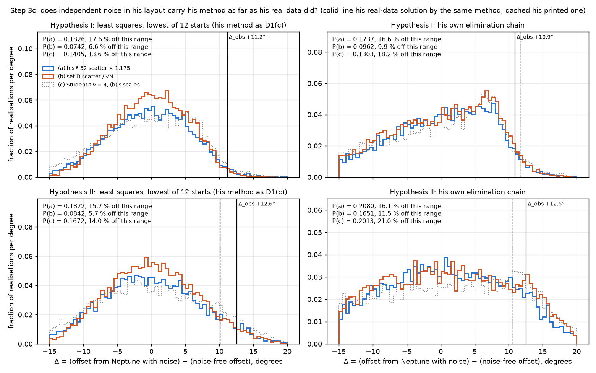
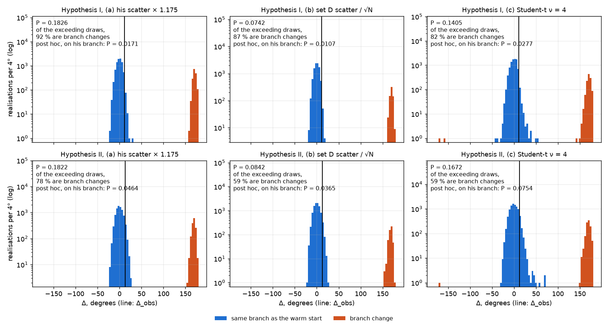

# Phase 1b, step 3c: is the shift between clean data and Adams's real-data solution within noise?

Pre-registered plan. Written 2026-11-11 after step 3b's results (commit 4a3301d); nothing below
§ 1–7 runs until the plan is committed, and the pre-registered sections are then byte-identical
(amendments and results only below the lines). Code and tests cite this note.

## Pre-registration (before any code or run)

### 0 Where step 3b left it

On one noise-free Neptune truth, his layout (30 normal places at his epochs) and his method
(the eight-parameter least squares with his § 52 weights, "D1(c)") at α = 0.5 placed the planet
at a heliocentric true longitude of 319.66° (ecl_j2000) for 1846.762, **9.51° short of
Neptune's 329.17° in the same model** (his own elimination chain: 9.92° short). His real data
through the same method (C2, which is Brookes's 1970 correction of Hypothesis I) place it at
328.05° of date against Neptune's 327.03°, **1.02° past**; his printed solution 328.77°, 1.74°
past. Step 3b read this as "his nearness on real data owes to his data or to compensating
errors" (Q3 row 3) and named the candidates A1–A5 and his reductions without ranking them.

### 1 Question

Is the shift between the clean-data solution and his real-data solution, **each method against
its own clean baseline** on the 1846.762 heliocentric true longitude,

- D1(c): Δ_obs = O(D1(c) on his real § 9 data, step 3b R4: 328.68° − 327.03° = +1.65°) − O_clean
  (−9.51°) = **+11.16°** (Hypothesis I);
- his chain: Δ_obs = O(C2, his chain on his real data = Brookes's correction: +1.02°) − O_clean
  (−9.92°) = **+10.94°**;
- secondary target, his printed solution: +1.74° − (−9.51°) = +11.25° against D1(c)'s baseline;
- Hypothesis II at α = 0.515: the same two differences from step 3b's D1(c) (332.00°, +4.97°) and
  C2 (331.48°, +4.45°) and the noise-free (i) solutions at 0.515, which step 3b did not compute
  and the pre-run record will (same code, his t_h2 and § 52 Hypothesis II weights),

within what independent observational noise produces in his layout through his method, or does
it require a systematic? "Systematic" means anything a smooth error in the data could be:
Bouvard's tables and his § 7 corrections, the construction of the normal places, a reduction
error common to a series. The step does not attribute further than that (Bouvard's tables are
not in the cache).

### 2 Design

Start from step 3b's noise-free his-layout normal places (D3(i): the truth's Uranus longitudes
at his 30 epochs minus the Bouvard-base "C", converted by r²/(ab); `cheap.json`'s
`d3.synthetic_places.oc_mean_arcsec`, recomputed by the same code and checked against it to
10⁻⁶″). To each of the 29 places used (1690 set aside as he did) add independent Gaussian noise,
ε_j ~ N(0, σ_j²), one draw per place per realisation; solve; repeat **10,000 realisations per
noise model**, seed `np.random.default_rng([2026, 11, 3, 8, model, hyp])` (model 0 = (a),
1 = (b); hyp 1, 2); the same 10,000 noise vectors (in units of σ_j) are reused across methods
within a model so that the two methods are compared on identical data.

**Two noise models, bracketing:**

- **(a) his own residual scatter.** σ_j = RMS of his printed § 52 residuals, modern and ancient
  separately, **scaled by √(N/(N − p)) = √(29/21) = 1.175** (N = 29 places, p = 8 parameters, the
  one factor applied to both groups): Hypothesis I raw 1.24″ (21 modern) and 6.21″ (8 ancient),
  scaled 1.46″ and 7.30″; Hypothesis II raw 1.22″ and 6.29″, scaled 1.44″ and 7.39″. The raw
  values are noted in every table. **Conditioned on his own fit**: residuals of his solution, so
  they understate the noise by more than the factor if his model is not exact; said in every
  table.
- **(b) set D's scatter propagated to 3-year normal places.** Per group, the RMS of step 3's
  H1(G) best-fit residuals about the fitted group offset, RA measurements only (his normal places
  are longitudes): ancient 5.48″ (18), Greenwich 2.22″ (87), Paris 1835–1845 2.18″ (40). Per
  place, σ_j = RMS_g / √N_j with N_j the number of set D observations whose epoch lies within
  ±1.518 yr (half his interval) of a modern place or within ±1 yr of an ancient one, and g the
  group those observations belong to. The counts from set D (each observation falls in exactly
  one window): ancient 1712: 1, 1715: 3, 1750: 2, 1753: 1, 1756: 1, 1764: 1, 1769: 8, 1771: 1;
  modern 1783: 19, 1786: 6, 1789: 15, 1792: 14, 1795: 11, 1798: 6, 1801: 2, 1807: 2, 1810: 1,
  1828: 6, 1831: 5 (Greenwich); 1834: 13, 1837: 17, 1840: 10 (Paris). **Seven modern windows
  hold no set D observation** (1780, 1804, 1813, 1816, 1819, 1822, 1825; Table 77 carries no
  Greenwich rows for 1811–1827 and set D excludes Paris 1801–1827), so N_j is **floored at 1**
  there and σ_j is the single-measurement scatter of Greenwich (2.22″). This makes (b) wider
  than the truth at those places (his normal places there rest on observations Table 77 does not
  carry), which biases (b) toward "noise suffices"; a "systematic required" reading that survives
  (b) is therefore the robust one. (b) treats his normal places as means of set D's measurements,
  which they are not exactly (Bouvard's and Greenwich's reductions); that is the point of
  bracketing with (a).

Neither model carries a group offset (step 3's τ_g): a common shift of a whole series is a
systematic of the kind the question sets against noise, not noise, and is the first candidate
if the reading says "systematic required".

**Sensitivity (c), reported and not read:** Student-t noise with ν = 4 and model (b)'s scales
(ε_j = σ_j · t₄), seed `[2026, 11, 3, 8, 2, hyp]`, the same 10,000 realisations through both
methods; it shows what heavier tails do to P and enters no reading row.

**Methods** (both at α = 0.5 for Hypothesis I, 0.515 for II, the printed series constants and
§ 28/45 forms, as D3(i)):

- primary, **D1(c)**: the eight-parameter weighted least squares (weights 1/RMS² of his § 52
  residuals, as in step 3b) started from the noise-free solution (one start: the method that gave
  −9.51°; a warm start is what an iterated solution does), m′ ≥ 0 and e′ ≤ 1 enforced;
- secondary, **his own chain** (C2 run on the noisy column: his normal equations, eliminations,
  § 25 multipliers, logarithmic equations, root choice by the smallest D1(c)-weighted χ² among the
  positive-mass roots, as D3(i) did).

Per realisation: θ, m′, e′, β′, the mean and the true longitude at 1846.762 (ecl_j2000, the
data's frame; the offset is frame-free), O = true longitude − T (T = 329.17°, the truth's
Neptune), and Δ = O − O_clean, where O_clean is the noise-free solution's offset by the same
method (−9.51° / −9.92°; Hypothesis II's from the pre-run record). **Escapes are outcomes**: a
draw that converges to another minimum is kept with its actual Δ (counted as `escaped`, θ more
than 30° from the clean θ, for description). Only non-convergence (`failed`: no convergence of
the least squares, or no positive-mass root of the chain) is excluded; failures are counted,
and if they exceed 1 % a second P that counts every failure as exceeding Δ_obs (an upper bound)
is stated beside the first. `bound` (m′ or e′ on a bound) is counted, not excluded.

**Multistart check.** For the first 1,000 realisations of each model × hypothesis, D1(c) is also
solved from a grid of 12 θ starts (every 30°, m′ 0.8, e′ 0.1, β′ the clean value) and the lowest
χ² kept; the fraction of realisations where this global minimum differs from the warm-start
solution by more than 1° in the 1846.762 true longitude is reported. **If it exceeds 1 %, all
draws are rerun with the multistart before the reading** (the warm start then stays as a
description of what an iterated solution would have done).

### 3 What is computed and reported

For each hypothesis × noise model × method: the distribution of Δ (quantiles 2.5, 16, 50, 84,
97.5 %, the mean and SD), the distribution of O, of the mean longitude, of m′ and e′ (as
description), the flagged fractions, and

**P = P(Δ ≥ Δ_obs), one-sided**, with its binomial standard error, for the primary target
(C2) and the secondary (his printed solution); the number of exceeding draws stated (at
P = 0.003 that is 30 of 10,000, so the threshold is resolved).

P is over the converged realisations (escapes included). Also: the SD of Δ against the
least-squares formal σ of the clean solution (step 3b: σ_θ 1.49° for (i)), as a check that the
noise propagation and the covariance agree under (a); and the multistart fraction of § 2.

### 4 Reading, fixed in advance

Read on Hypothesis I, primary method (D1(c)) against its own Δ_obs (+11.16°); his chain against
its own (+10.94°), Hypothesis II and the printed target reported beside, and any disagreement
between the two methods said per row. Sensitivity (c) enters no row.

| outcome | reading |
|---|---|
| P ≥ 0.05 under **both** (a) and (b) | **Noise suffices**: a shift as large as his is produced by independent observational noise in his layout at least one time in twenty; his nearness to Neptune on real data is within luck, and no systematic is needed to explain it (none is excluded, see below). |
| P < 0.003 under **both** | **A systematic is required**: independent noise of either size does not carry his method 10.5° from where clean data put it. Named candidates, not ranked and not attributed further without Bouvard's tables: Bouvard's 1821 tables and his § 7 corrections to them (what the "C" he subtracted contained), the construction of the normal places (which observations, which weights, which reductions), a reduction error common to a series. |
| otherwise | **Weak**, stated per model: the P under each, which model admits it and which does not, and no single statement. |

**What independent noise cannot do.** The draws are independent per place; a smooth systematic
(a slow error in Bouvard's elements, a series-wide offset) is correlated across places and is
exactly what the noise models do not contain, so "noise suffices" does not exclude a systematic:
it says one is not needed. Conversely "systematic required" does not say which; the candidates
above are where to look, and the first of them needs Bouvard's tables, which this study does not
have. The reading is about the real-data solution's distance from the clean one, not about the
truth: both solutions are measured from Neptune only because that is the fixed point step 3b
used.

### 5 Report order

R1 the σ_j tables for (a) (raw and scaled) and (b) with the counts and the frozen inputs'
hashes; R2 the clean solutions and Δ_obs per hypothesis, method and target; R3 the Δ
distributions (table and figure: histograms of Δ per model and method with each method's Δ_obs
marked, Hypothesis I above II, (c) beside); R4 P with standard errors and exceeding counts; R5
the failed, escaped and bound fractions, the multistart fraction and the SD–covariance check;
R6 the reading rows; R7 what remains unseparated. Results appended below the lines of this note;
`docs/notes/P1B_adams_noise.{json,png}`; a ledger row `p1b_adams_noise/draws`; the site
untouched; nothing in step 3b's note edited.

### 6 Cost and order of work

One warm-start least-squares solve takes 25 ms, one run of his chain 34 ms (measured on the
D3(i) column with noise). 10,000 realisations × 3 noise models × 2 hypotheses × 2 methods is
60,000 + 60,000 solves, plus 12 × 1,000 × 6 multistart solves, about 25 + 34 + 30 CPU-minutes,
run in a process pool (12 workers) in about 8 minutes wall; **minutes, not seconds; not
detached**, no checkpoint (a rerun is cheaper than one). A multistart rerun of all draws, if
§ 2 calls for it, adds about 5 CPU-hours (12 × 60,000 solves), still not detached. Order:
the pre-run record (σ_j tables, the Hypothesis II clean solution at 0.515, Δ_obs), the tests, the
draws, the summary and figure, the results below the lines; one commit for the plan, one for the
pre-run record and code, one for the results; no trailers.

### 7 Layout

`src/fork/historical/adams_1846.py` gains `noise_sigmas(m, model, counts)` and
`solve_warm(rows, w, s, x0)` (the one-start least squares with the flags); the runner
`src/fork/export/p1b_adams_noise.py` (`prerun`, `draws`, `summarize`), caches in
`data/cache/p1b_adams_noise/`; tests in `tests/test_p1b_adams_noise.py`: the seeds, the noise-free
draw reproduces D3(i)'s solution to 10⁻⁶, the σ tables and counts, the reading rows on
constructed P, the frozen inputs (`cheap.json`'s synthetic column is regenerated, not read, and
compared).

### 8 Amendments made on approval (2026-11-11, before the commit; nothing runs before it)

1. Escapes are outcomes: draws converging to another minimum are kept with their actual Δ; only
   non-convergence is excluded (counted; upper-bound P if > 1 %). Warm start stays primary, with
   a multistart check on 1,000 draws per model × hypothesis (12 θ starts, lowest χ² kept; the
   fraction differing from the warm start by > 1° in the 1846.762 longitude reported); if > 1 %,
   every draw is rerun with the multistart before the reading.
2. Δ_obs per method against its own clean baseline: D1(c) on his real § 9 data (+1.65°) minus
   D1(c) clean (−9.51°) = +11.16°; his chain on real data (C2, +1.02°) minus his chain clean
   (−9.92°) = +10.94°. Both reported; the reading uses each method's own.
3. Model (a): σ scaled by √(N/(N − p)) = 1.175, the one factor on both groups; raw RMS noted.
4. Sensitivity (c): Student-t ν = 4 with model (b)'s scales, same seed namespace; reported, not
   part of the reading rule.
5. The empty-window count corrected: seven modern windows (1780, 1804, 1813, 1816, 1819, 1822,
   1825), not eight.

---

## Results (2026-11-11; code and pre-run record 9beae34; draws 21:12–23:27 PST on 12 workers; nothing above the lines edited)

Report order R1–R7 of § 5. Every number is in `P1B_adams_noise.json`; the figures are
`P1B_adams_noise.png` and `P1B_adams_noise_branches.png`. Offsets O and shifts Δ are on the 1846.762 heliocentric true longitude in
the data's frame (ecl_j2000 for the synthetic draws, of date for his real-data solutions; an
offset from Neptune in the same frame is frame-free). "Converged" means the least squares
stopped on a tolerance, or the chain had a positive-mass root; nothing else was excluded.

### Summary

Under independent noise his shift of about 11° toward Neptune occurs in about 1–2 % (Hypothesis
I) and 4–5 % (Hypothesis II) of the draws that stay on his branch of the solution (a post hoc
statistic, R6b). Neither luck nor a systematic is established. Bouvard's tables remain the named
route to attribution. The pre-registered rule reads "noise suffices" in every multistart and
chain row (R6a), but its statistic measures how often noise switches the solution to a second
minimum nearly opposite Neptune, not how often noise carries the solution toward Neptune
(deviation 5).

### Deviations from the plan as written

1. **Multistart on every draw, and primary for the reading.** § 2 (amendment 1) set a multistart
   check on 1,000 draws with a full rerun if more than 1 % differed by more than 1°. A 40-draw
   smoke run before the full run differed in 2.5–25 % of the draws per cell. The trigger fired,
   so the full run carried the 12-start multistart (lowest χ² kept) on every realisation. The
   reading's primary method is the multistart global minimum; the warm start is reported beside
   it. Δ_obs for D1(c) was recomputed with the same 12-start multistart on the clean column and
   on his real § 9 data before reading: the same minima as before, Δ_obs unchanged (R2). The
   per-cell fraction of branch changes is a lower bound, since 12 starts need not find every
   minimum.
2. **Cost and the detached run.** The plan put the cost at about 1.5 CPU-h, minutes of wall
   time, not detached. The multistart costs about 2 s per draw; the run took 126 minutes of
   wall time on 12 workers, about 25 CPU-h. A first full run (19:04–21:10, results held in memory
   and collected in submission order) was stopped after 2 h 06 min with nothing saved: its log
   had stalled at 72 of 240 chunks for 78 minutes while the workers stayed busy. The system log
   for 19:00–21:15 shows no memory-pressure kill and no crash report; the workers held about
   120 MB each; no stuck draw was found offline on the chunk being waited for. **The cause of
   the stall is not established.** The run was relaunched detached (nohup, caffeinate) with one
   result file per chunk written by its worker, progress logged per chunk, a 60 s wall-clock
   watchdog per solve, exceptions and timeouts recorded per draw as flags, cells (a) and (b)
   before (c), and (c)'s solves capped at 500 function evaluations with capped starts counted.
   No chunk stalled in the relaunch.
3. **Three chunks of (c) recomputed.** Three chunks of sensitivity (c) failed with a math domain
   error: a chain solution with e′ ≥ 1 has no longitude. The code was changed to flag such a draw
   (commit 671241f) and the three chunks were recomputed with the same seeds (6.6 minutes).
   Three chain draws in 20,000 carry the flag (R5).
4. **Window counts.** The set D counts by the pre-registered rule differ from the list printed
   in § 2 at six Greenwich windows (R1). The rule governs.
5. **The plan's statistic treats an angle as linear (identified after reading).** P(Δ ≥ Δ_obs)
   is one-sided on Δ wrapped to (−180°, +180°]. His least-squares problem has a second minimum
   at θ ≈ 95° (R3b). A draw whose global minimum is there has Δ ≈ +160° to +175° and counts as
   exceeding, although it lies nearly opposite Neptune. Between 59 % and 92 % of the exceeding
   draws in cells (a) and (b) are of this kind. The defect is in the plan's statistic and was
   identified after the P values were read. **The pre-registered P values therefore measure the
   frequency of branch switching, not noise carrying the solution toward Neptune.** They are
   reported as the rule gives them (R4, R6a). A post hoc statistic, labelled post hoc wherever
   it appears, is reported beside them (R6b).
6. **Flag rule, set before reading.** If flagged draws (timeout, capped solve, exception,
   non-convergence) exceed 1 % of a cell, P is the interval [P over converged draws, P with
   every flag exceeding], and a cell whose interval crosses a threshold reads "weak". No cell
   reached 1 % (R5), so every P is a single number.
7. **Additions to the report, description only:** the branch description and its figure (R3b),
   the warm-start rows, the second minimum on the clean and real data.

### R1 The frozen inputs and the σ_j tables

The synthetic column (D3(i)'s O − C in mean-longitude seconds at his 30 epochs) regenerated by
step 3b's code agrees with step 3b's cached column to 0.0″ (bit-identical); the memoir tables'
SHA-256 and the step-3 frozen inputs (Table 77, the error model, his solutions, Challis's
sweeps) are in the JSON. The truth's Neptune at 1846.762: 329.171° ecl_j2000, 327.031° of date.
The Bouvard-base "C": a 19.137 AU, e 0.0474, β 47.43°, ε(1810.328) 220.705° ecl_j2000 (step 3b).

**Model (a).** His § 52 residual RMS, raw and scaled by √(29/21) = 1.1751:

| hypothesis | modern raw (21) | modern scaled | ancient raw (8) | ancient scaled |
|---|---|---|---|---|
| I | 1.240″ | 1.457″ | 6.211″ | 7.299″ |
| II | 1.225″ | 1.439″ | 6.294″ | 7.397″ |

Conditioned on his own fit: the residuals of a solution with eight parameters on 29 places; the
factor is exact only if his model is exact, so (a) remains the lower bracket.

**Model (b).** Step 3's H1(G) best-fit residual RMS about the fitted group offsets, RA only:
ancient 5.481″ (18 measurements), Greenwich 2.217″ (87), Paris 1835–1845 2.181″ (40). The set D
observations per window by the rule of § 2 (±1.518 yr about a modern place, ±1 yr about an
ancient one, the epoch from its TT Julian Date), every one of the 145 falling in exactly one
window:

| place | 1712 | 1715 | 1750 | 1753 | 1756 | 1764 | 1769 | 1771 | 1780 | 1783 | 1786 | 1789 | 1792 | 1795 | 1798 | 1801 | 1804 | 1807 | 1810 | 1813–1825 (5) | 1828 | 1831 | 1834 | 1837 | 1840 |
|---|---|---|---|---|---|---|---|---|---|---|---|---|---|---|---|---|---|---|---|---|---|---|---|---|---|
| N_j | 1 | 3 | 2 | 1 | 1 | 1 | 8 | 1 | 0 | 17 | 8 | 12 | 15 | 12 | 7 | 2 | 0 | 2 | 1 | 0 | 6 | 5 | 13 | 17 | 10 |
| σ_j (″) | 5.48 | 3.16 | 3.88 | 5.48 | 5.48 | 5.48 | 1.94 | 5.48 | 2.22 | 0.54 | 0.78 | 0.64 | 0.57 | 0.64 | 0.84 | 1.57 | 2.22 | 1.57 | 2.22 | 2.22 | 0.91 | 0.99 | 0.60 | 0.53 | 0.69 |

**The counts differ from the list printed in § 2 at six Greenwich windows** (1783: 17 not 19;
1786: 8 not 6; 1789: 12 not 15; 1792: 15 not 14; 1795: 12 not 11; 1798: 7 not 6). The list in
§ 2 was made with a month-rounded parse of the epochs when the plan was written; the rule (the
window on the epoch) is what was pre-registered and what the code applies. The group totals
(18, 87, 40), the ancient and Paris counts, and the seven empty modern windows (1780, 1804,
1813, 1816, 1819, 1822, 1825; floored at N = 1, σ = 2.22″) are as listed. The effect on σ_j is
at most 0.06″ at one place. The same σ_j serve both hypotheses (set D does not depend on his
hypothesis) and sensitivity (c).

### R2 The clean solutions and Δ_obs

Both methods on the noise-free column, each hypothesis at his α (0.5; 0.515):

| hyp | method | θ | m′ | e′ | β′ | mean lon 1846 (ecl_j2000) | true lon | O_clean | χ² (weights c) |
|---|---|---|---|---|---|---|---|---|---|
| I | D1(c), multistart = warm | 318.88 | 0.817 | 0.0965 | 275.8 | 317.02 | 319.66 | **−9.512°** | 3.23 |
| I | his chain (6 roots, 2 positive mass) | 318.77 | 0.834 | 0.0918 | 273.8 | 317.14 | 319.25 | **−9.923°** | 3.32 |
| II | D1(c) | 320.14 | 0.740 | 0.0810 | 281.1 | 318.27 | 321.55 | **−7.621°** | 3.40 |
| II | his chain (6, 2) | 320.01 | 0.757 | 0.0763 | 278.3 | 318.40 | 321.04 | **−8.127°** | 3.50 |

Hypothesis I's rows are step 3b's D3(i) to the last figure. Hypothesis II at α = 0.515 lands
1.9° nearer Neptune than Hypothesis I on the same clean data, as D2's rising profile of true
longitude with α predicts (step 3b R5: 328.7 at 0.50, 331.0 at 0.51 on his real data).

His real-data solutions by the same methods (of date, step 3b) against Neptune's 327.031° of
date, and Δ_obs = O_real − O_clean per method:

| hyp | method | real-data true lon | O_real | Δ_obs (primary) | Δ_obs vs his printed solution |
|---|---|---|---|---|---|
| I | D1(c) on his § 9 data | 328.678 | +1.647° | **+11.158°** | +11.254° (printed 328.774, O +1.743°) |
| I | his chain on his data (C2 = Brookes) | 328.052 | +1.021° | **+10.944°** | +11.666° |
| II | D1(c) | 331.995 | +4.964° | **+12.585°** | +10.085° (printed 329.495, O +2.464°) |
| II | his chain (C2) | 331.478 | +4.447° | **+12.574°** | +10.591° |

The formal uncertainty of the clean solution, unscaled (√diag (JᵀWJ)⁻¹ with W = 1/RMS², no
χ²/dof factor): σ_θ 3.81° (I), 3.57° (II); under (a), whose noise is 1.175 × RMS, the
propagated SD of θ should be 1.175 × these = 4.48° and 4.19° (the R5 check). Step 3b's quoted
σ_θ 1.49° is the same quantity scaled by √(χ²/dof) = √(3.23/21), which is the right scaling for
clean data fitted by an exact model and not for noise at his residuals' level.

**The clean χ² (3.23 and 3.40) is not noise.** The clean column carries no noise, so this χ² is
the misfit of his linear model to the truth at the assumed distance, in units of his weights.

**Δ_obs by the draws' own solver.** The 12-start multistart on the clean column and on his real
§ 9 data finds the same minima as the earlier solves: χ² 3.2276 and 28.4875 (I), 3.4003 and
28.5938 (II); Δ_obs +11.158° and +12.585°, unchanged to 0.0001°.

### R3 The Δ distributions

Quantiles of Δ over the 10,000 draws per cell, in degrees. "Multistart" is the reading's
primary solver; "warm" is the one-start solution of the same draws.

| cell | solver | 2.5 % | 16 % | 50 % | 84 % | 97.5 % | SD |
|---|---|---|---|---|---|---|---|
| I (a) | multistart | −12.0 | −5.9 | +1.4 | +165.2 | +174.5 | 64.4 |
| I (a) | warm | −12.2 | −6.4 | −0.1 | +5.8 | +10.5 | 6.0 |
| I (a) | chain | −15.4 | −7.4 | +2.3 | +12.0 | +176.1 | 59.9 |
| I (b) | multistart | −10.5 | −5.5 | +0.6 | +6.8 | +170.5 | 42.0 |
| I (b) | warm | −10.7 | −5.8 | 0.0 | +5.5 | +9.6 | 5.4 |
| I (b) | chain | −16.6 | −8.7 | +1.4 | +8.8 | +172.9 | 40.7 |
| I (c) | multistart | −14.1 | −7.0 | +1.2 | +9.6 | +173.9 | 55.2 |
| I (c) | warm | −14.6 | −7.7 | −0.1 | +6.6 | +11.6 | 7.2 |
| I (c) | chain | −21.3 | −11.1 | +1.6 | +9.6 | +175.0 | 49.3 |
| II (a) | multistart | −13.2 | −6.7 | +1.4 | +14.6 | +172.2 | 59.4 |
| II (a) | warm | −13.3 | −7.2 | 0.0 | +7.6 | +14.3 | 7.2 |
| II (a) | chain | −16.4 | −8.8 | +2.3 | +15.2 | +174.2 | 54.3 |
| II (b) | multistart | −12.0 | −6.4 | +0.5 | +8.4 | +168.4 | 37.0 |
| II (b) | warm | −12.0 | −6.6 | 0.0 | +7.0 | +13.7 | 6.7 |
| II (b) | chain | −18.2 | −10.5 | +1.0 | +12.7 | +169.0 | 32.8 |
| II (c) | multistart | −15.4 | −8.1 | +1.2 | +13.0 | +172.1 | 51.2 |
| II (c) | warm | −15.7 | −8.6 | −0.1 | +9.3 | +16.9 | 8.8 |
| II (c) | chain | −22.9 | −13.1 | +1.6 | +14.4 | +173.3 | 42.9 |

The figure shows −15° to +20° only; each panel states the fraction of draws off that range.

### R3b The second minimum and the branch changes (description only)

**A property of his inverse problem.** His eight-parameter least-squares problem has a second
minimum, present without noise:

| data | hyp | best: θ, χ² | second: θ | e′ | m′ | χ² above the best | offset from Neptune |
|---|---|---|---|---|---|---|---|
| clean column | I | 318.88°, 3.23 | 96.27° | 0.433 | 0.777 | 7.07 | +159.7° |
| his real § 9 data | I | 310.27°, 28.49 | 89.21° | 0.454 | 0.840 | 6.93 | +165.2° |
| clean column | II | 320.14°, 3.40 | 96.45° | 0.448 | 0.654 | 6.91 | +160.2° |
| his real § 9 data | II | 311.85°, 28.59 | 89.06° | 0.477 | 0.700 | 7.09 | +164.1° |

It is a planet of high eccentricity (e′ ≈ 0.44) placed about 160° from Neptune at 1846.762.
It sits about 7 in χ² above the best minimum on the clean data and on his real data alike.
Noise reverses the order of the two minima in 5–17 % of draws.

**Branch changes among the exceeding draws.** A branch change is a draw whose multistart
minimum is more than 1° from its warm start in the 1846.762 longitude (a lower bound, 12
starts).

| cell | draws that change branch | exceeding (Δ ≥ Δ_obs) | of which branch changes | their θ − real-data θ (2.5 %, 50 %, 97.5 %) | within 10° of the real-data θ |
|---|---|---|---|---|---|
| I (a) | 16.8 % | 1,826 | 1,684 (92 %) | +136°, +144°, +153° | 0 |
| I (b) | 6.4 % | 742 | 642 (87 %) | +140°, +146°, +153° | 0 |
| I (c) | 11.6 % | 1,405 | 1,158 (82 %) | +136°, +146°, +157° | 0 |
| II (a) | 14.2 % | 1,822 | 1,424 (78 %) | +135°, +142°, +151° | 0 |
| II (b) | 5.0 % | 842 | 495 (59 %) | +137°, +144°, +152° | 0 |
| II (c) | 9.9 % | 1,672 | 992 (59 %) | +133°, +144°, +156° | 0 |

Every exceeding branch change lands on the second minimum (θ ≈ 86°–103°), 120° to 180° from
the real-data θ of 310.27° (I) and 311.85° (II). None lands near his real-data solution. The
chain shows the same: 3.5–13.7 % of its draws per cell are more than 30° from the clean
solution, at Δ near +172°.

### R4 P(Δ ≥ Δ_obs), the pre-registered statistic

Exceeding counts over converged draws; the binomial standard error is at most 0.0044.
See deviation 5 for what these numbers measure.

| hyp | method | target | (a) | (b) | (c), not read |
|---|---|---|---|---|---|
| I | multistart (primary, headline) | same method | 1,826: 0.1826 | 742: 0.0742 | 1,405: 0.1405 |
| I | multistart | his printed solution | 1,821: 0.1821 | 731: 0.0731 | 1,395: 0.1395 |
| I | his chain | same method | 1,737: 0.1737 | 962: 0.0962 | 1,303: 0.1303 |
| I | his chain | his printed solution | 1,633: 0.1633 | 850: 0.0850 | 1,205: 0.1205 |
| I | warm start | same method | 175: 0.0175 | 109: 0.0109 | 299: 0.0299 |
| I | warm start | his printed solution | 169: 0.0169 | 98: 0.0098 | 288: 0.0288 |
| II | multistart (primary) | same method | 1,822: 0.1822 | 842: 0.0842 | 1,672: 0.1672 |
| II | multistart | his printed solution | 2,204: 0.2204 | 1,223: 0.1223 | 2,181: 0.2181 |
| II | his chain | same method | 2,080: 0.2080 | 1,651: 0.1651 | 2,013: 0.2013 |
| II | his chain | his printed solution | 2,546: 0.2546 | 2,186: 0.2186 | 2,636: 0.2637 |
| II | warm start | same method | 472: 0.0472 | 362: 0.0362 | 777: 0.0777 |
| II | warm start | his printed solution | 937: 0.0937 | 768: 0.0768 | 1,345: 0.1345 |

### R5 Failed, escaped and bound fractions; the multistart fraction; the SD check

**Flags.** No timeout, no capped solve and no least-squares exception in any cell. Every
least-squares draw converged. The chain failed on 1 draw of 10,000 in I (c) and 2 in II (c)
(e′ ≥ 1, no longitude); these are excluded from the chain's P in those cells, far below the
1 % rule. No draw of the primary solver ended on a bound; one warm-start draw did in each (c)
cell. The chain had six real roots and two of positive mass in every draw of (a) and (b).

**Escapes** (|Δ| > 30°, kept as outcomes):

| cell | multistart | warm | chain |
|---|---|---|---|
| I (a) | 16.84 % | 0 | 13.66 % |
| I (b) | 6.42 % | 0 | 5.71 % |
| I (c) | 11.68 % | 0.09 % | 9.31 % |
| II (a) | 14.24 % | 0 | 11.08 % |
| II (b) | 4.95 % | 0 | 3.49 % |
| II (c) | 10.02 % | 0.09 % | 7.07 % |

**Multistart fraction** (minimum more than 1° from the warm start; in every such draw the
multistart χ² is the lower): on the first 1,000 draws 17.0 %, 5.7 %, 10.0 % (I a, b, c) and
14.1 %, 4.0 %, 13.0 % (II); on all 10,000 draws 16.84 %, 6.42 %, 11.60 % and 14.24 %, 4.95 %,
9.93 %. All above the 1 % trigger; lower bounds.

**SD against the covariance, model (a).** On the warm-start branch the SD of θ over the draws
is 4.34° (I) and 4.15° (II) against the propagated 4.48° and 4.19°. The linear propagation
holds on the branch to 3 %. Over all multistart draws the SD of θ is 84° and 79°, which is the
second minimum and not a property of the branch.

### R6a The reading by the pre-registered rule

| hyp | method, target | P(a) | P(b) | row of § 4 |
|---|---|---|---|---|
| **I** | **multistart, same method (headline)** | **0.183** | **0.074** | **noise suffices** |
| I | multistart, printed | 0.182 | 0.073 | noise suffices |
| I | his chain, same method | 0.174 | 0.096 | noise suffices |
| I | his chain, printed | 0.163 | 0.085 | noise suffices |
| I | warm start, same method | 0.018 | 0.011 | weak |
| I | warm start, printed | 0.017 | 0.010 | weak |
| II | multistart, same method | 0.182 | 0.084 | noise suffices |
| II | multistart, printed | 0.220 | 0.122 | noise suffices |
| II | his chain, same method | 0.208 | 0.165 | noise suffices |
| II | his chain, printed | 0.255 | 0.219 | noise suffices |
| II | warm start, same method | 0.047 | 0.036 | weak |
| II | warm start, printed | 0.094 | 0.077 | noise suffices |

As the rule gives it: "noise suffices" in every multistart and chain row. **By deviation 5 this
reading does not answer the question asked.** The exceeding draws are mostly solutions nearly
opposite Neptune. Sensitivity (c) is reported in R4 and not read.

### R6b Post hoc statistic: P on his branch

**Post hoc.** Defined after the pre-registered P was read. P(Δ ≥ Δ_obs) among the draws whose
multistart minimum lies on the real-data branch, θ within 30° of the real-data θ. Read against
the same thresholds (0.003 and 0.05).

| cell | draws on his branch | exceeding | P, post hoc (SE) | against his printed solution, post hoc |
|---|---|---|---|---|
| I (a) | 83.16 % | 142 | 0.0171 (0.0014) | 137: 0.0165 |
| I (b) | 93.58 % | 100 | 0.0107 (0.0011) | 89: 0.0095 |
| I (c), not read | 88.36 % | 245 | 0.0277 (0.0017) | 235: 0.0266 |
| II (a) | 85.76 % | 398 | 0.0464 (0.0023) | 780: 0.0910 |
| II (b) | 95.05 % | 347 | 0.0365 (0.0019) | 728: 0.0766 |
| II (c), not read | 90.06 % | 679 | 0.0754 (0.0028) | 1,188: 0.1319 |

Post hoc reading on the same-method target: **weak in all four cells**, Hypothesis I at
0.011–0.017 and Hypothesis II at 0.037–0.046. Neither threshold is passed. One row differs:
Hypothesis II against his printed solution (Δ_obs +10.08°) reads "noise suffices" post hoc, at
0.091 and 0.077. The post hoc P agrees with the warm-start P of R4 to 0.001, since the draws
on his branch are the draws where the multistart kept the warm-start solution.

### R7 What remains unseparated

- **Luck against a systematic.** On his branch, independent noise at the level of his own
  residuals or of set D's scatter produces his shift in 1–2 % of draws under Hypothesis I and
  4–5 % under Hypothesis II. That is uncommon and not excluded. Neither luck nor a systematic
  is established.
- **The systematic's source.** A smooth error in Bouvard's tables or his § 7 corrections, the
  construction of the normal places, or a series-wide reduction error would each act as a
  correlated shift that independent noise cannot mimic. Bouvard's tables remain the named route
  to attribution; nothing here attributes the shift.
- **The noise level.** (a) is conditioned on his own fit and (b) on set D's reduction; the
  heavy-tailed (c) raises the post hoc P to 0.028 (I) and 0.075 (II). A noise model with
  correlated or group-offset errors was not run.
- **The second minimum.** It is 7 in χ² above his solution on his real data. Whether Adams's
  own procedure could have landed there is a question about his root choice, not answered here.
- **The stall of the first run** has no established cause (deviation 2).

The ledger row `p1b_adams_noise/draws` is in the local compute ledger only. The site is
untouched. Nothing in step 3b's note was edited.

### 2026-11-12: binned shifts for the companion page (nothing above edited; `P1B_adams_noise.json` not edited)

`docs/notes/P1B_adams_noise_hist.json` (sha256 `a0ca3937bd9ce47ddcd2cb5d62584587dfc51ac073a677c70aabc12493dbfa95`), written by
`uv run python -m fork.export.p1b_adams_noise hist` from the cached draws: the shift toward
Neptune of the multistart solution on every draw, wrapped to −180° to 180° and binned at 5°,
for Hypotheses I and II under noise models (a) and (b). The command checks, per cell, that the
number of draws at or above Δ_obs on the unwrapped statistic equals the summary's count
(1826, 742, 1822, 842) before it writes. It adds no reading; it is the data of the companion
page's Fig. 2.
