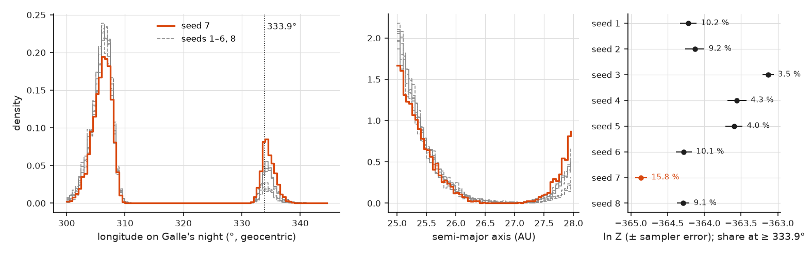

# The low-distance solution by its own region, and when the 95 % range is final

**Pre-registration, 15 November 2026.** Written before any code of this plan exists and
before any sampling under it. Everything below the line at the end is added after this plan
is pushed: amendments and results, dated, never edits to the text above it.
It follows `S1_cell0.md`, whose reading was "not resolved, the sub-cells do not make the runs
repeatable", and M8's 95 % rule (`M8.md`, "M8b"), whose condition 4 failed.

## 0 Scope and questions

The headline's 95 % range of the longitude on Galle's night is labelled "provisional" for two
reasons (`S1_cell0.md` § 5):

- **(i) the low-distance solution.** Under S1 (eccentricity up to 0.5) a solution near 315°,
  at a ≈ 24 AU and e ≈ 0.32, carries a posterior weight P(a < 25 AU) that the runs so far put
  anywhere from 0.001 to about 0.2;
- **(ii) M8b's condition 4.** The spread of each 95 % bound over the four single-seed fits of
  the headline was 0.415° and 0.510°, against 0.4°.

**Question A.** Computed on the region where it lives, with a sampler built for curved modes,
is the evidence of the low-distance solution repeatable across eight seeds, and if so, what is
P(a < 25 AU)?

**Question B.** With eight single-seed fits of the headline in place of four, is the sampler
error of each merged 95 % bound at most 0.2°?

**Then:** § 6 says when the 95 % range is final and what it becomes.

Not in scope: the headline's median and 68 % interval (they stay the replacement ones, as
M8's rule says), any other sensitivity run, the site (changed only after the results, on
approval).

## 1 Inputs, fixed

| input | file | SHA-256 |
|---|---|---|
| observations | `data/historical/leverrier_1846.csv` | `2f546b9979f613c62d9c2dc77cd92b8269a9dbea4d3f87eecf39d2145509ebc4` |
| error model | `data/historical/m6_error_model.json` | `0856fa30d1675bf926d3921580de919b45fb72474e2f41ba58a5d153a6bec277` |
| reference Uranus for the fast likelihood | `docs/notes/M8_u_ref.json` | `4bf4537c88ab2364c7f46247d87489de7beaa3031b677d8080435887caa4b3c5` |
| fast likelihood | `src/fork/model/perturbative.py` | `092f673b9352f9d2b0ae709f2a4d3f258dd09806245b767fd83b86e8ecccd68c` |
| full likelihood with Uranus marginalised | `src/fork/model/linearized.py` | `3e02e78bdd9ee74fb96a6666f192188c355113addc92f43e376729f0b616d15e` |
| reweighting | `src/fork/inference/reweight.py` | `d0c5fbff6066ebaa531bc24668fa807a8f7bf0aa96cf77eead5c07aca9cd021b` |
| S1's other cells, published | `site/data/m6_fits.json` | `2d111e7fcb7a71100a72a8f963f6c8f0f26aea9da90ff22a246893618bb74fff` |
| S1's other cells, fast likelihood | `site/data/m8_runs.json` | `4d50867272ab7ce6faec99ef3db1edb30e6b25ba61223f8adc0304c65f88b6cb` |
| M8b's four headline seeds | `site/data/m8b.json` | `355104b24966ce216f53ff603931a060a4a5e738a996a683db5fac5c5e962027` |
| the sub-cell run, for the region of § 2 | `docs/notes/S1_cell0.json` | `df29b5dc6c05882f319a341bea011b253858f3417d5cf2a9e48873acb7e327ec` |

The runner refuses to start if any differs. Part A's data set, priors and space are S1's,
unchanged (`m6c.dataset("s1_e05")`, free distance, e ≤ 0.5, inclined perturber); Part B's are
the headline's, as in M8b.

## 2 Part A: the regions

S1's prior is split into five regions. Their prior masses are fixed by the space and add up
to 1:

| region | definition | prior mass |
|---|---|---|
| **M**, the low-distance solution | a in [22.5, 25] AU, e in [0.2, 0.5] | 0.057542 |
| **L**, the rest of cell 0 | a in [20, 22.5) AU with any e; a in [22.5, 25] AU with e < 0.2 | 0.145572 |
| cell 1 | a in [25, 28) AU | 0.103156 |
| cell 2 | a ≥ 28 AU, the lower e cell of `nested.cells_for(0.5)` | 0.166495 |
| cell 3 | a ≥ 28 AU, the upper e cell | 0.527235 |

L is two boxes, sampled as two runs and added.

**Why M is drawn there.** In `S1_cell0.md` the cut at e = 0.35 ran through the solution
(e = 0.319, 16 to 84 %: 0.301 to 0.337), and its tail beyond 0.35 (sub-cell 5, 2.5 % of the
evidence) was one of the sub-cells whose seeds did not agree. M is the union of that run's
sub-cells 4 and 5, which held 99.9 % of cell 0's evidence. It encloses the solution in e on
both sides; in a its lower edge is 2.6 posterior widths below the median (a = 23.94 AU, 16 to
84 %: 23.39 to 24.48), and its upper edge is a = 25 AU because that is where the question
P(a < 25 AU) draws it. M was placed from those published summaries only; no sample of any
earlier run was looked at.

**Cell 0's evidence** is Z₀ = (w_M Z_M + w_L Z_L) / (w_M + w_L), and P(a < 25 AU) is cell 0's
share with S1's prior masses, as `m8_arbiter.implied_p_below_25`, whose check values (0.00104
and 0.109) are reproduced before it is applied.

## 3 Part A: the method

**Likelihood.** The fast (perturbative) likelihood of M8 over the perturber's 7 parameters,
Uranus marginalised, second order off, step 60 d, cubic quadrature, as in `S1_cell0.md` stage
A; each posterior then reweighted to the full likelihood with Uranus marginalised (mode (b)),
6,000 equal-weight draws, chunks of 250, ln Z = ln Z_fast + ln mean exp(Δ), Galle-night
longitude per draw through the full model.

**Sampler: a different one.** UltraNest (`ReactiveNestedSampler`, version pinned in the
lock file), with its slice step sampler:

- step sampler `SliceSampler`, directions from `generate_mixture_random_direction` (a mixture
  of directions along the region's principal axes and differences of two live points; the
  second follows a curved ridge, since the live points themselves lie along it);
- nsteps 28 (four times the 7 dimensions);
- at least 4,000 live points (`min_num_live_points`), `max_num_improvement_loops` 0 (a static
  run), `dlogz` 0.1, `frac_remain` 0.001;
- periodic parameters wrapped (`wrapped_params`), as in the dynesty runs;
- one process per run, resumable from its own output folder (`resume="resume"`), progress
  logged.

**Seeds.** Eight per region, s = 1 to 8, rng `[2026, 15, 1846, 1, r, s]` with r = 1 for M,
2 and 3 for the two boxes of L, 4 to 6 for cells 1 to 3.

**The stronger-settings check (X).** In M only: two further runs, s = 101 and 102, with 8,000
live points and nsteps 56. Seed agreement tests noise, not exploration (`M8.md`, "The
lesson"), so this is the test of exploration.

**Quantities, per posterior:** ln Z (UltraNest's own error reported beside); ESS/N of the
reweighting; Galle-night median and 68 % width (`m6c.lon_summary` on resampled draws); in M
also a and e (16, 50, 84 %). Per region, the eight seeds' merge: ln Z as the log of the mean
of the eight Z, with its sampler error from their spread (standard deviation over seeds / √8).

## 4 Gates and tests of Part A, fixed in advance

**G0, the sampler on a known answer** (before any real run). A 7-dimensional twisted
Gaussian in the unit cube (five independent Gaussian coordinates of width 0.03, and a pair
x₁ ~ N(0.5, 0.06), x₂ − 0.5 − b((x₁ − 0.5)² − 0.06²) ~ N(0, 0.01) with b = 12, so the ridge
bends by about 17 of its own widths across ±2 widths of x₁). Its ln Z is known in closed form
up to a truncation computed once by quadrature. With the settings of § 3, eight seeds: every
seed within 0.3 of the true ln Z, and the eight within 0.5 of each other.

**G1 to G3**, as in `S1_cell0.md`: every run stops on its stopping rule (not on a cap); ESS/N
≥ 0.3 for every reweighted posterior; the truncation of the marginal over Uranus below 10⁻⁶ in
−2 ln L at every draw where the full likelihood is finite.

**R, repeatability across the eight seeds** (the gate the question turns on):

- **R1, ln Z.** Largest minus smallest of the eight reweighted ln Z ≤ 0.5 in M and in cells 1
  to 3; ≤ 1.0 in each box of L, if L's merged share of cell 0's evidence is below 0.01 (a
  share s that moves by a factor e changes ln Z₀ by at most s(e − 1); at s < 0.01 that is
  under 0.02). If L's share is 0.01 or more, 0.5 applies to it too.
- **R2, the solution's place.** In M, the sampler error of the merged Galle-night median is at
  most 0.2°, and each seed's 68 % width is within 10 % of the eight seeds' mean.

**X, exploration.** The merge of the two stronger runs in M against the eight-seed merge: ln Z
within 0.5, median within 0.35°, 68 % width within 10 % (A8b's tolerances).

**G4, the reweighting in M (its failure stops the reading).** For each of the eight seeds'
posteriors in M, for their merge and for the merge of X's two runs, the effective sample size
of the reweighting from the fast to the full likelihood, ESS = (Σ wᵢ)² / Σ wᵢ² over the 6,000
draws with wᵢ = exp(Δᵢ − max Δ): **ESS/N ≥ 0.5**. It is stricter than G2's 0.3, which applies
everywhere, because M is where the reading is made. For the record: the smallest ESS/N of the
sub-cell run (`S1_cell0.md`, G2) was 0.895, so 0.5 was fixed knowing that the earlier runs
cleared it.

A value within 0.02 of a tolerance (ln Z), 0.02° (median) or 0.5 points (width) is reported as
"at the tolerance" and counted as it falls.

## 5 Part B: the headline's 95 % bounds with eight seeds

*A revised rule: the target is unchanged at 0.2°, seeds are added, and it was written after
condition 4 of M8b's rule failed.*

**What changes from M8's rule, and why.** Condition 4 asked that each 95 % bound's spread
over four single-seed fits be at most 0.4°, "so the merged bound's sampler error (std/2) is ≤
0.2°". The target is the merged bound's sampler error; four seeds was the means. This plan
keeps the target, 0.2°, and reaches it with more seeds. It is a revised rule, written after
condition 4 failed, and labelled as such. With the four existing seeds' spreads (0.415°,
0.510°), eight seeds would give about 0.15° and 0.18°: I state that so that the choice of
eight is seen to be made knowing it.

**Runs.** M8b's campaign exactly (headline data set, its four cells, the fast likelihood,
dynesty `multi`/`rslice`, M8b's live points and 28 slices, dlogz 0.1, the reweighting), with
seeds 5 to 8 added to the existing 1 to 4, by M8b's own rng rule. 16 new runs. The existing
runs are used as they are.

**Rule B.** The eight-seed merged 95 % interval replaces M6c's provisional one (320.18° to
330.40°) if all hold:

1. every gate of M8b passes for seeds 5 to 8 and for the eight-seed merge;
2. A8b and A8c pass (they passed for M8b and are not rerun);
3. A8f passes in all four cells over the eight seeds;
4′. for each 95 % bound, the standard deviation over the eight single-seed fits divided by
    √8 is at most 0.2°.

The reported median and 68 % interval stay the replacement ones (325.82°, 323.57° to
327.79°), as before.

## 6 Reading, fixed in advance

**Part A.** If G4 fails, **the reading stops**: no P(a < 25 AU) and no word are stated from
this plan, the failure is reported with its numbers, and the table below is read as "not
resolved". If G0 to G4, R and X all hold: **resolved.** P(a < 25 AU) is read with S1's rule
(above 0.5 "moved", 0.05 to 0.5 "moved partly", below 0.05 "not at all"), using all five
regions from this plan. If P ± 2 sampler errors crosses 0.05 or 0.5, the verdict is "between"
the two words. If the word differs from the published "not at all", S1's verdict is corrected
by an erratum line that keeps the old number visible. P against the published and the fast
other cells (M and L from this plan, cells 1 to 3 from those files) is reported beside it,
not read.

If a gate fails, or R, or X: **not resolved**, with the failed test and its numbers. The
published verdict stands and the weight stays "0.001 to about 0.2".

**The 95 % range, when final and what it becomes.**

| Part B | Part A | the 95 % range |
|---|---|---|
| rule B holds | resolved, P < 0.05 | **final**: the eight-seed merged interval with its two sampler errors; no label. S1's solution is stated as under 5 % |
| rule B holds | resolved, P ≥ 0.05 | **final for the headline's prior (e ≤ 0.3)**: the eight-seed merged interval with its sampler errors, no label, and beside it: "With the eccentricity allowed to 0.5, a second solution near L° (a ≈ A AU) holds P of the posterior, outside this range", with L, A and P from this plan |
| rule B holds | not resolved | the eight-seed interval replaces M6c's; the label stays, for one reason: the low-distance solution, weight 0.001 to about 0.2 |
| rule B fails | either | not replaced; the label stays, with the failed condition and, from Part A, either its resolved P or "unresolved" |

No interval of the headline other than the 95 % one is recomputed.

## 7 What this cannot show

- Anything about the headline's posterior from Part A: S1 is a different prior.
- That a different sampler or a different region would agree: one of each is run, with one
  check at stronger settings.
- That the fast likelihood is right in detail: it is reweighted everywhere, with no
  full-likelihood sampling. The full-likelihood check of `S1_cell0.md` (T2) is not repeated:
  two runs of it disagreed with each other, at about 50 CPU-h each.
- Whether the low-distance solution is physical.

## 8 Choices made in this plan

| choice | made as | why |
|---|---|---|
| the sampler | UltraNest's slice sampler with live-point difference directions | slice-based; its directions follow a curved ridge; a different code from every earlier run |
| live points | 4,000, and 8,000 in X | 4,000 matched the earlier runs' ln Z error; X doubles both live points and steps |
| seeds | 8 | at least 6 asked; 8 gives √8 in R2 and in rule B |
| M's edges | the union of the earlier sub-cells 4 and 5 | encloses the solution in e; fixed from published summaries |
| likelihood | fast, reweighted | 45 posteriors at about 50 CPU-h each with the full likelihood is out of reach; ESS/N tests the reweighting |
| other cells | rerun with the new method, the two old sets reported beside | P is a ratio, and both sides should come from one method |
| Part B | included | without it no outcome of Part A can make the range final |
| G4 | ESS/N ≥ 0.5 in M, stopping the reading | the reading is made in M; stricter than G2 |

## 9 Order, cost, layout

- Order: plan frozen and pushed; the runner and its tests; G0; a capped smoke run in a scratch
  cache; Part A's 42 runs and Part B's 16 runs side by side on 12 workers; the reweighting;
  the summary. No reading in between.
- Cost (estimates; the ledger records each run, whatever its outcome): an UltraNest run at
  4,000 live points and nsteps 28 makes about as many calls per iteration as dynesty's 28
  slices did, so about 1.5 to 2.5 CPU-h; Part A about 40 × 2 + 2 × 8 ≈ 100 CPU-h; reweighting
  about 5; Part B about 24 (M8b's seed 1 took 5.6 CPU-h for four cells). In all about 130
  CPU-h, 11 h on 12 workers.
- New dependency: `ultranest` (with `h5py`), pinned in `uv.lock`.
- Layout: `src/fork/export/s1_mode.py`, `tests/test_s1_mode.py`, cache
  `data/cache/nested/s1_mode/`, results `docs/notes/S1_mode.json`.

---

## Amendment 1, 15 November 2026, before any run of Part A or B

**A count in § 9 is wrong; the text of §§ 2 and 3 governs.** § 3 asks for eight seeds in each
region and § 2 samples L as two boxes, so Part A has six sampled regions and 6 × 8 + 2 = 50
runs, not 42: § 9 counted L as one region, and its cost line (40 × 2 + 2 × 8) did the same.
With 50 runs Part A is about 115 CPU-h and the whole about 145 CPU-h. Nothing else changes.

**Choices the plan leaves open, fixed in the runner before any run** (`src/fork/export/s1_mode.py`,
commits 05a2dd3 and 6f7f3d4 on branch s1-mode; its docstring states them):

- UltraNest draws from numpy's global generator, which the runner seeds with the plan's rng
  list. A run resumed after a stop continues from its stored points with a new generator
  state, so it is not bit-identical to an uninterrupted run.
- A fast log-likelihood that is not finite is passed to UltraNest as −1e300.
- A region's eight-seed merge is the pooled posterior: 750 of each seed's 6,000 reweighted
  draws (3,000 of each of X's two). Its ln Z is the log of the mean of the seeds' Z, as § 3
  says; its ESS/N (for G2 and G4), median and widths come from the pooled draws, so the merge
  needs no likelihood call of its own.
- The sampler error of P(a < 25 AU) is propagated to first order from each region's merged ln Z
  error (standard deviation over seeds / √n); "P ± 2 sampler errors" in § 6 uses it.
- Part B's seeds 5 to 8 are run by `m8_runs`' own job command into M8b's cache, with M8b's rng
  rule. The eight-seed merge (dynesty's merge of seeds 1 to 8, as M8b merged four) is drawn and
  reweighted in this plan's cache, with M8b's rng list and 8 appended, so none of M8b's
  four-seed files is rewritten. Before any new run, the summary code was run on seeds 1 to 4
  and M8b's own merge and reproduced `site/data/m8b.json` exactly (the 95 % bounds' spreads
  0.4151° and 0.5097°, every fit, A8f); a test keeps that.

**Before the runs.** G0 passed on 15 November (data/cache/nested/s1_mode/g0.json): true ln Z
−0.0004; the eight seeds within −0.120 to +0.076 of it (tolerance 0.3), range 0.196
(tolerance 0.5); about 300 CPU-s and 13.7 million calls per seed. The capped smoke run of the
whole pipeline in a scratch cache (66 runs at 150 iterations, 12 draws each) went through the
reweighting and the summary; the check values of `implied_p_below_25` were reproduced (0.00104
and 0.10902). Nothing of the smoke run is read.

## Results, 15 November 2026

The pipeline ran at commit 6f7f3d4 from 14 November 19:18 to 15 November 05:44 PST on 12
workers: Part A's 50 runs and Part B's 16, then the reweighting and the summary, 108.4 CPU-h in
all (ledger), with no failed or resumed run. Results: `docs/notes/S1_mode.json`. The text above
the line, amendment 1 included, is unchanged.

### Part A: not resolved

R1 fails in cell 1; every other gate and test holds.

| test | value | tolerance | |
|---|---|---|---|
| G0 | largest deviation 0.120, range 0.196 | 0.3, 0.5 | holds |
| G1 | no run stopped on a cap (0 of 50) | | holds |
| G2 | smallest ESS/N 0.911 (cell 1, seed 3) | 0.3 | holds |
| G3 | largest truncation 2.7 × 10⁻¹¹³ | 10⁻⁶ | holds |
| G4 | smallest ESS/N in M 0.912 (seed 3); M's merge 0.915; X's merge 0.918 | 0.5 | holds |
| R1, M | ln Z range 0.450 | 0.5 | holds |
| R1, L's two boxes | 0.583 and 0.305 (L's share of cell 0 is 0.0008, so 1.0 applies) | 1.0 | holds |
| **R1, cell 1** | **ln Z range 1.732** (seed 3 −363.130, seed 7 −364.862) | 0.5 | **fails** |
| R1, cells 2 and 3 | 0.359 and 0.140 | 0.5 | holds |
| R2 | sampler error of the median 0.053°; widths within 5.3 % of their mean | 0.2°, 10 % | holds |
| X | ln Z −0.030, median −0.051°, 68 % width +3.9 % | 0.5, 0.35°, 10 % | holds |

By § 6, a failed R makes Part A **not resolved**: the published verdict stands and the weight of
the low-distance solution stays "0.001 to about 0.2". As § 6 says, P(a < 25 AU) from this plan
is not stated. The check values of `implied_p_below_25` were reproduced (0.00104, 0.10902).

### Part B: rule B holds

1. **M8b's gates, for seeds 5 to 8 and the eight-seed merge.** Gate 1 (as amended in `M8.md`,
   the reweighting share ≥ 0.5): 0.9965 to 0.9967 on all nine fits (ESS/N as written 0.270 to
   0.276, reported beside, as in M8b). Gate 2: smallest ESS/N 0.935 over 36 cell posteriors.
   Gate 3: smallest 0.995 over 18 branch posteriors. Gate 4: largest truncation 1.2 × 10⁻¹¹⁰.
   This condition was assessed on gates 1 to 4, because M8's gate 5 (the blind-spot checks)
   was registered as a set of reports without a pass condition. Holds.
2. **A8b and A8c,** not rerun: they passed for M8b. Holds.
3. **A8f, all four cells over the eight seeds:** largest relative deviation of a seed's 68 %
   width 0.020, 0.045, 0.050 and 0.039 in cells 0 to 3, against 0.1. Holds.
4′. **Sampler error of each 95 % bound:** standard deviation over the eight single-seed fits
   0.293° (lower) and 0.417° (upper), divided by √8: 0.104° and 0.147°, against 0.2°. Holds.

### The 95 % range

§ 6, third row (rule B holds, Part A not resolved): the eight-seed merged interval,
**319.61° to 330.15°** (sampler errors 0.10° and 0.15°), replaces M6c's 320.18° to 330.40°.
It stays **provisional**, for one reason: the low-distance solution, weight 0.001 to about 0.2.
The headline's median and 68 % interval are unchanged (325.82°, 323.57° to 327.79°).

### Post hoc: cell 1, seed 7 against the other seven seeds

*Post hoc, not part of this plan; it changes no reading above.* From the stored reweighted
draws of cell 1, with no new sampling, every seed has two modes, not only seed 7: one against
the cell's lower edge (a = 25.07 to 25.64 AU, 16 to 84 % over all seeds; longitude near 306°)
and one against its upper edge (a = 27.62 to 27.96 AU; near 334°). The share of draws at or
beyond 333.9° is 15.8 % in seed 7 and 3.5 % to 10.2 % in the other seeds (the whole upper mode,
beyond 320°: 22.6 %, and 5.1 % to 14.5 %), so seed 7 differs in degree, not in kind. Split
between the two modes, the seeds' ln Z agree on the upper mode (range 0.29) and not on the lower
one (range 1.94). Broadly, the seeds that give the lower mode less weight have the lower
ln Z, seed 7 most of all. The spread of 1.73 is 13 to 23 times each seed's own sampler error (0.07 to 0.13).
R1's failure in cell 1 therefore comes from the mode at the cell's lower edge, a = 25 AU, the
boundary with M. Figure: `S1_mode_cell1.png`, made by `scripts/s1_mode_cell1.py`, with its
numbers in `S1_mode_cell1.json`.

