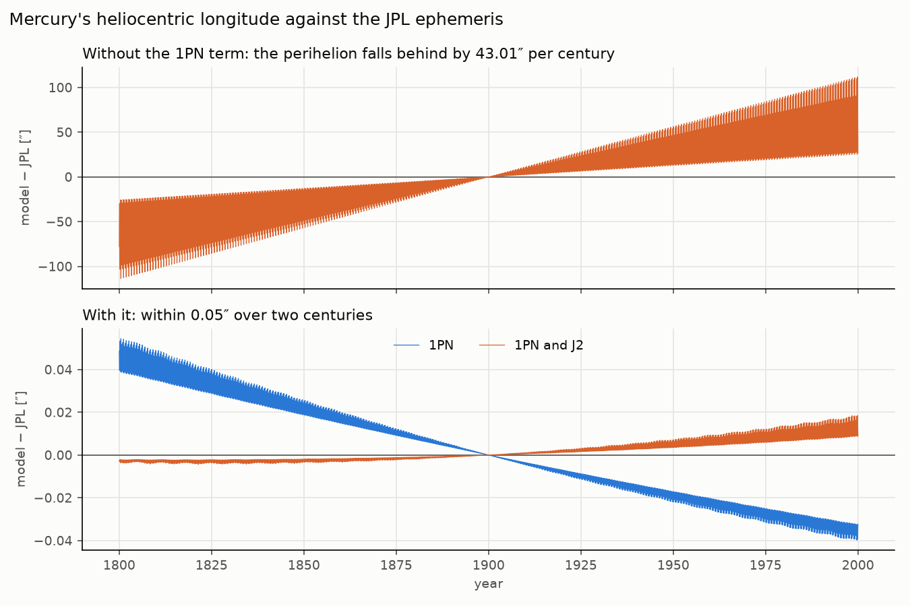
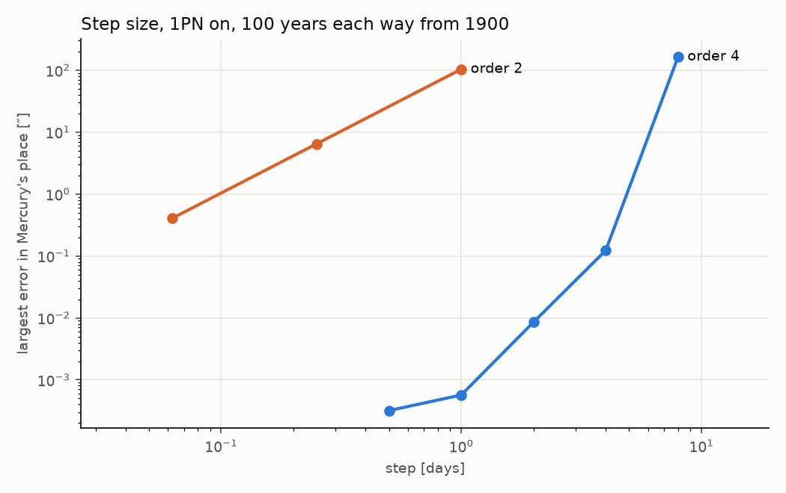

# Phase 2 physics: validation V1–V5

12 November 2026. Engineering checks of the forces added for Phase 2. No observation of
Mercury is fitted here and nothing in this note is an inference result.

## What was added

| piece | where | off by default |
|---|---|---|
| The Sun's 1PN term, with a scale `gr` and PPN β, γ | `src/fork/integrators/wh_extra.py` | yes |
| The Sun's J2, spin axis as an input | same | yes |
| A uniform circular ring about the Sun (mass, radius, normal) | same | yes |
| A point planet inside Mercury's orbit | an extra body, as the Phase 1 unseen planet | yes |
| Forward model θ → Mercury's longitude, one optional block of θ per piece | `src/fork/model/inner_system.py` | yes |

No Phase 1 file is edited. The new integrator module calls the Phase 1 map's own functions,
and with every force off its result equals `wisdom_holman.integrate_states` bit for bit
(`tests/test_phase2_physics.py`, first test). Nothing in Phase 1 imports the new modules.

**The 1PN form.** a = gr · μ/(c² r³) · { [2(β+γ) μ/r − γ v²] r + 2(1+γ)(r·v) v }, μ = GM☉, r
and v heliocentric: the Schwarzschild term of the IERS Conventions (2010), eq. 10.12, which
is the single-body form of Nobili and Roxburgh (1986) and of REBOUNDx's `gr`. General
relativity is gr = β = γ = 1. Because the term depends on velocity, its kick is an implicit
midpoint step in v at fixed r. The reaction on the Sun is neglected.

**J2.** a = −(3/2) J₂ μ R²/r⁵ · { [1 − 5 (r·s)²/r²] r + 2 (r·s) s }, R = 696,000 km, s the
spin axis (IAU pole α₀ = 286.13°, δ₀ = 63.87° in the forward model).

**Ring.** Φ = −(2 G m/π) K(k²)/√((R+ρ)²+z²), k² = 4Rρ/((R+ρ)²+z²); the force is its exact
gradient. Checked against a sum over 20,000 points of the ring and against a numerical
gradient of Φ.

## Results

Long runs: `uv run python -m fork.phase2.validation run`, 84 s in all on one core, every
number below from `docs/phase2/validation.json`. Elements used in V1–V3: a = 0.38709893 AU,
e = 0.20563069 (Mercury's mean elements at J2000), Mercury's mass 1/6,023,600 M☉.

### V1, the 1PN advance: pass

Sun and Mercury only, 1,000 years, with and without the term; the slope of the perihelion
longitude, in arcseconds per Julian century. Analytic: gr (2+2γ−β)/3 · 6πGM/(c² a (1−e²))
per orbit. Tolerance 0.1″ per century.

| gr | β | γ | measured | analytic | difference |
|---|---|---|---|---|---|
| 1 | 1 | 1 | 42.98047 | 42.98047 | −0.000001 |
| 0.5 | 1 | 1 | 21.49024 | 21.49024 | +0.000004 |
| 1 | 1.2 | 1 | 40.11511 | 40.11511 | −0.000002 |
| 1 | 1 | 0.8 | 37.24974 | 37.24974 | +0.000001 |

### V2, J2 = 2.2 × 10⁻⁷: pass

1,000 years. Analytic secular rates dω/dt = (3/4) n J₂ (R/p)² (5cos²i − 1) and
dΩ/dt = −(3/2) n J₂ (R/p)² cos i, i the inclination to the Sun's equator. Tolerance 5 %.

| i | dω/dt measured | analytic | dΩ/dt measured | analytic | largest relative difference |
|---|---|---|---|---|---|
| 3.38° | 0.055689 | 0.055689 | −0.027917 | −0.027917 | under 10⁻⁶ |
| 30° | 0.038453 | 0.038453 | −0.024219 | −0.024219 | under 10⁻⁶ |

At Mercury's inclination the perihelion longitude advances by 0.0278″ per century.

### V3, an interior mass: pass

1,000 years, the mass in Mercury's orbital plane. Reference: the orbit-averaged rate in the
ring's exact field (Gauss's equation, any eccentricity). The lowest-order Laplace–Lagrange
rate, (n/4)(m/M) α b₃⸝₂⁽¹⁾(α), is checked on a nearly circular orbit (e = 0.02), where it
applies; at Mercury's e = 0.206 it is 12 to 30 % too small and is not the reference. The
point planet is on a circle at the ring's radius. Tolerance 5 %.

| mass [M☉] | radius [AU] | ring, measured | ring, analytic | ratio | point planet | ratio | e = 0.02 against Laplace–Lagrange |
|---|---|---|---|---|---|---|---|
| 1 × 10⁻⁷ | 0.15 | 9.4014 | 9.4014 | 1.0000 | 9.4013 | 1.0000 | 1.0012 |
| 1 × 10⁻⁷ | 0.25 | 67.1107 | 67.1107 | 1.0000 | 67.1559 | 1.0007 | 1.0029 |
| 3 × 10⁻⁷ | 0.15 | 28.2042 | 28.2042 | 1.0000 | 28.2039 | 1.0000 | 1.0012 |
| 3 × 10⁻⁷ | 0.25 | 201.3326 | 201.3320 | 1.0000 | 201.5935 | 1.0013 | 1.0029 |

### V4, the real ephemeris

Sun and eight planets (planetary systems as single bodies at their barycentres, IAU 2009
masses) from the JPL Horizons states at 1900 January 1.0 TDB, integrated to 1800 and to
2000; Mercury's heliocentric ecliptic longitude against Horizons at 3,599 epochs, every
20.3 days. Order 4, step 1 day. Horizons served its current default planetary ephemeris (the
version string was not recorded; DE440/441 is expected but not confirmed); the states are cached in `data/cache/phase2/`, and 39 epochs are committed as a
test fixture.

| model | largest longitude difference, 1800–2000 | trend of the perihelion residual |
|---|---|---|
| Newtonian | 113.6″ | −43.01″ per century |
| with 1PN | 0.054″ | −0.027″ per century |
| with 1PN and J2 | 0.018″ | +0.001″ per century |

Residual in longitude by decade, model minus Horizons, arcseconds (mean; root mean square):

| decade | Newtonian | with 1PN | with 1PN and J2 |
|---|---|---|---|
| 1800 | −55.71; 62.76 | +0.04; 0.04 | 0.00; 0.00 |
| 1820 | −43.85; 49.41 | +0.03; 0.03 | 0.00; 0.00 |
| 1840 | −32.12; 36.24 | +0.02; 0.02 | 0.00; 0.00 |
| 1860 | −20.43; 23.10 | +0.01; 0.01 | 0.00; 0.00 |
| 1880 | −8.75; 10.03 | +0.01; 0.01 | 0.00; 0.00 |
| 1900 | +2.92; 3.79 | 0.00; 0.00 | 0.00; 0.00 |
| 1920 | +14.60; 16.58 | −0.01; 0.01 | 0.00; 0.00 |
| 1940 | +26.31; 29.69 | −0.02; 0.02 | 0.00; 0.00 |
| 1960 | +38.07; 42.92 | −0.02; 0.02 | +0.01; 0.01 |
| 1980 | +49.95; 56.30 | −0.03; 0.03 | +0.01; 0.01 |

(Every decade is in the JSON.) Without the term the perihelion falls behind the ephemeris
by 43.01″ per century; in longitude the residual drifts by 56″ per century in the mean
and reaches 114″ at a century from the epoch. With the term the residual stays within 0.054″ over the two
centuries, and its trend, −0.027″ per century in the perihelion, is the Sun's J2 (V2: 0.028):
adding J2 leaves 0.018″ over two centuries. What remains is the model's (the Moon and the
asteroids are not separate bodies; mass values), not the integrator's (V5).



### V5, conservation and step size

Conservation, 1,000 years, order 4, step 1 day (largest relative change):

| term on | system | energy | angular momentum |
|---|---|---|---|
| 1PN | Sun and a massless Mercury; the 1PN energy and angular momentum of a test particle | 4.5 × 10⁻¹³ | 2.7 × 10⁻¹³ |
| none | Sun and eight planets | 1.0 × 10⁻¹² | 3.4 × 10⁻¹³ |
| J2 | the same; energy with the term's potential, momentum about the axis | 7.9 × 10⁻¹³ | 1.7 × 10⁻¹³ |
| ring | the same | 5.8 × 10⁻¹³ | 2.1 × 10⁻¹³ |
| J2 and ring | the same | 4.1 × 10⁻¹³ | 1.3 × 10⁻¹³ |

Step size: Mercury's place after 100 years each way from 1900, eight planets, against a
reference at order 4 and 0.125 day; the largest difference as seen from the Sun, arcseconds.

| order | step [days] | Newtonian | 1PN | J2 | ring | seconds for 200 years |
|---|---|---|---|---|---|---|
| 2 | 1 | 103.6 | 103.6 | 103.6 | 103.6 | 0.15 |
| 2 | 0.25 | 6.47 | 6.47 | 6.47 | 6.47 | 0.6 |
| 2 | 0.0625 | 0.40 | 0.40 | 0.40 | 0.40 | 2.1 |
| 4 | 8 | 164 | 164 | 164 | 165 | 0.07 |
| 4 | 4 | 0.128 | 0.123 | 0.128 | 0.128 | 0.13 |
| 4 | 2 | 0.0088 | 0.0085 | 0.0087 | 0.0090 | 0.26 |
| 4 | 1 | 0.0008 | 0.0006 | 0.0006 | 0.0011 | 0.5 |
| 4 | 0.5 | 0.0001 | 0.0003 | 0.0001 | 0.0002 | 0.9 |

**The step, and why.** Phase 1's second-order map at its 12-day step is unusable for
Mercury (88-day period), and even at 1 day it is 104″ off after a century: the error is a
phase drift that grows with time and falls only as the square of the step. The fourth-order
composition of the same map (Yoshida 1990: three second-order steps of 1.351, −1.702 and
1.351 times the step) reaches 0.001″ per century at a 1-day step, at 0.5 s per 200 years
of eight planets. **Phase 2 default: order 4, step 1 day** (`inner_system.DEFAULT_DT_DAYS`,
`DEFAULT_ORDER`). A point planet at 0.15 AU has a 21-day period and was run at 0.25 day.



## Reproduce

```
uv run python -m fork.phase2.reference --fetch      # network: Horizons states → data/cache/phase2/
uv run python -m fork.phase2.reference --fixture    # the committed 39-epoch subset
uv run pytest -q tests/test_phase2_physics.py       # V1–V5 on short spans, 15 s
uv run python -m fork.phase2.validation run         # the long runs → docs/phase2/validation.json
uv run python -m fork.phase2.validation plot        # the two figures
```

## Limits

- The 1PN term is the Sun's only; the planets' own post-Newtonian terms and the Sun's
  reaction are left out. Against the ephemeris this costs less than 0.02″ in two centuries.
- The ring and J2 act on the planets as fixed fields centred on the Sun.
- V4 compares with an ephemeris that itself contains general relativity; it shows that the
  integrator and the term reproduce it, nothing more.
